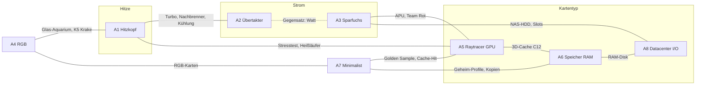

# BOTTLENECK – Game Design v0.2 (Erweiterung)

> Bezug: `docs/game-design.md` (GDD v0.1, bleibt gültig), `docs/implementation-notes.md`, `docs/progress.md`, umgesetzter Content in `src/core/data/*.ts`.
> Dieses Dokument beschreibt nur **Neues und Geändertes**. Alles, was hier nicht steht, gilt wie im GDD v0.1 bzw. wie umgesetzt.
> Status: Entwurf v0.2 · Alle Zahlen sind Startwerte für Simulation und Spieltest.
> Assets dazu: `docs/assets-v0.2.md`.

---

## 0. Ausgangslage und Ziele

### 0.1 Befund aus v0.1

| Befund (Sim, P1-Bot) | Folge für v0.2 |
|---|---|
| Bot-Stärke wächst bis Gen 6 um ×1,8 je Gen, ab Gen 8 nur noch ×1,1–1,3. Spätes Wachstum ist fast nur additiv (Treiber, Zwangs-Update, Shader-Cache). | **Neue ×Takt-Quellen**, auch solche, die über Generationen wachsen. |
| Echte ×-Quellen im MVP: nur SW3 Fake-Frames, SW6 Stresstest, Instabil-Karten. Keine legendäre Software. | Legendäre Software aktivieren, neue Verbesserungen (Golden Sample, Cache-Hit), ×-Quellen pro Archetyp. |
| Runs enden schmal bei Gen 8–11 (Median 10). | Zielkurve ab Gen 9 flacher beschleunigen; Ziel: Ende Gen 10–14, Median 12. |
| Plattformwechsel (MB3/MB7) kommen fast nie zustande. Netzteil P1 blockiert große Teile. | **Bundles** (Board + CPU, GPU + Netzteil), billiges AMX-5-Einstiegsboard, Gebrauchtmarkt. |
| Zu wenige Software-Slots (nur S1). | Günstige Slot-Quelle (NAS-HDD), Peripherie, Abo-Software. |
| Sparen für Zinsen ist fast immer richtig. | Mehr sinnvolle Ausgaben mit Rendite (Gutscheine, Sponsoren, Mining) und Risiken. |

### 0.2 Ziele v0.2

1. **Mindestens 5 klar unterscheidbare Build-Archetypen.** v0.2 liefert 8 (Kapitel 3), dazu 3 Querschnitts-Synergien (Marke/Team, Sleeper, Krypto).
2. **Jeder Archetyp hat mindestens eine eigene ×Takt-Quelle** und einen Konter-Boss.
3. **Ökonomie mit Entscheidungen:** neue Einnahmen und Rabatte, jeweils mit Kosten, Risiko oder Bindung.
4. **Realitätsnähe bleibt:** neue Teile sind echte Produktklassen (A620-Board, APU, T-CPU, 96-GB-Kit, NAS-HDD, Optane, Peltier, LN2, POST-Karte, Balkonkraftwerk, USV).
5. **Umsetzbar:** klarer Muss-Umfang (Kapitel 9), der fast ohne neue Screens auskommt.
6. **Kein Pech:** Alles Relevante ist vor einer Entscheidung sichtbar. Zufall gibt es nur bei Angeboten (Laden, Pakete) und bei Risiken, die der Spieler bewusst mit sichtbarer Wahrscheinlichkeit eingeht (Regel 2.4).

### 0.3 Entscheidungen des Auftraggebers

| # | Thema | Entscheidung | Umsetzung im Dokument |
|---|---|---|---|
| E1 | Run-Ende | Gen 12 ist das **Siegfinale „Weltrekord“**. Danach optional endlos weiterspielen (Highscore). | 7.2, 8, 11 |
| E2 | Zielkurve | Wird erst **nach einer Simulation** mit neuem Content und Bot festgelegt. Der Vorschlag (+0,2 ab Gen 9) ist nur der **Startwert**. | 7.2, 7.6, 9 |
| E3 | Pech | **Kein Pech.** Zustand und Defekte sind vor dem Kauf sichtbar, keine zufällig zerstörten Teile. Risiken nur bewusst und mit sichtbarer Wahrscheinlichkeit bzw. Folge (OC, Hitze). | neue Regel 2.4, alle Inhalte geprüft |
| E4 | Krypto | BottleCoin und Mining sind ok. Kursschwankungen sichtbar und berechenbar. | 6.8 (Börsenticker) |
| E5 | Starter-PCs | werden über Meta-Progression **freigeschaltet**. | 11.3 |
| E6 | Marken | Intellion darf GPUs bauen (Ark, wie Intel Arc). | 5.3 |
| E7 | Bot | Der Bot für die Simulation gehört zum **Umsetzungsauftrag**. | 7.6, 9.1 |
| E8 | Online | **Kein Backend**, alles lokal. Tages-Challenge über lokalen Seed nach Datum. | 11.3 |
| E9 | Assets | Der Auftraggeber erzeugt die Assets selbst mit der Bild-KI. | `assets-v0.2.md` |

---

## 1. Neue Mechaniken in Kürze

| # | Mechanik | Kurzbeschreibung | Prio |
|---|---|---|---|
| M1 | **Gehaltene Karten** | Karten, die nach „Ausführen“ auf der Hand bleiben, können Effekte auslösen (neuer Wertungsschritt 2b). Trägt den RAM-Archetyp. | Muss |
| M2 | **Teams (Marke)** | Jedes CPU/GPU-Teil gehört zu einem Team: Rot (AMX, Rubeon), Blau (Intellion, Intellion Ark), Grün (Veridia). Software und Plattform-Boni fragen das Team ab. | Muss |
| M3 | **Neue Verbesserungen** | Golden Sample (×1,5), Cache-Hit (2× werten), Krypto (+$1); dazu RGB und Heißläufer. | Muss (3) / Soll (2) |
| M4 | **Legendäre Software** | Seltenheit L ab Gen 3 (5 %), wie im GDD vorgesehen. | Muss |
| M5 | **Upscaler-Regel** | Fake-Frames und Fidelity-Upscaler schließen sich aus: nur der linke Upscaler wirkt. | Muss |
| M6 | **Gebrauchtmarkt** | Billige Teile mit **sichtbaren** Mängeln und Zuständen; Bastlerware mit angezeigten Reparaturkosten. | Muss |
| M7 | **Rückgabe & Garantie** | Neuteile bis zum Ende des nächsten Benchmarks zurückgeben (Gebühr $1, nicht nach OC). Garantieverlängerung verlängert die Rückgabe. | Muss / Soll |
| M8 | **Sponsor-Verträge** | Laufendes Einkommen, an Build-Bedingungen gebunden, mit Vertragsstrafe. | Muss |
| M9 | **Bundles & Angebote** | Aufrüst-Kit (Board + CPU ±RAM) −25 %, GPU + Netzteil −20 %, ein Tagesangebot −40 %. | Muss |
| M10 | **Gutscheine** | Dauerhafte Laden-Verbesserungen (Balatro-Voucher), 1 Angebot pro Generation. | Soll |
| M11 | **Krypto-Wallet & Mining** | Währung BottleCoin (BTL) mit schwankendem Kurs; Mining-Modus der GPU, ASIC-Karte. | Soll |
| M12 | **Peripherie** | 2 Plätze außerhalb des Gehäuses: Balkonkraftwerk, USV, Monitor … | Soll |
| M13 | **Geheim-Profile** | Penta-Core (5 gleiche Stufen) und Homogener Cluster (5 identische Karten), nur mit Deck-Manipulation. | Soll |
| M14 | **Zielkurve & Gen-12-Finale** | Startwert: Beschleunigung +0,2 statt +0,4 (endgültig nach Simulation, E2). Siegfinale in Gen 12 („Weltrekord“), danach optional endlos (E1). | Muss (Kurve) / Soll (Finale) |
| M15 | **Synergie-Tags** | Jedes Item zeigt Archetyp-Symbole (Hitze, OC, Eco, RGB …). | Soll (Muss als Text im Tooltip) |
| M16 | **Abo-Software** | Software ohne Kaufpreis, aber mit Kosten je Benchmark. | Soll |
| M17 | **Auktion** | Verkaufen für 70 % statt 50 %, dafür erst nach dem nächsten Benchmark (kein Zufall). | Soll |
| M18 | **Ratenkauf, Benchmark überspringen** | Schulden mit Aufschlag; Überspringen gegen Gutschein-Coupon. | Kann |
| M19 | **Meta aus GDD v0.1** | Starter-PCs, Garantie-Stufen, Kartenrücken, Tages-Challenge (Kapitel 11). | Soll |
| M20 | **Multi-GPU** | SLI-Brücke als Witz-Mechanik mit Mikrorucklern (Kapitel 11). | Kann |

---

## 2. Regeländerungen am Kern

### 2.1 Auflösungsreihenfolge (ersetzt GDD 6.3)

1. **Profil** (inkl. Treiber-Stufe).
2. **Gespielte Karten, links → rechts.** Pro Karte:
   1. Stufe → +L
   2. Verbesserung (Übertaktet, Optimiert, Effizient, Instabil, **Golden Sample, Heißläufer, RGB, Krypto**)
   3. Hardware-Trigger des Kartentyps
   4. Software-Trigger „pro Karte“ (z. B. Pathtracing-Overdrive, Jumbo-Frames)
   5. **Cache-Hit:** Die Schritte 1–4 laufen für diese Karte ein zweites Mal.
   - **2b (neu) Gehaltene Karten, links → rechts:** Effekte „pro gehaltener Karte“ (z. B. Prefetcher). Gehalten = nach dem Ausführen auf der Hand, nicht gespielt.
3. **Hardware global:** Mainboard → CPU-Basistakt → **Plattform-Bonus (SAM/Deep Link)** → Kühler → Gehäuse → Lüfter → Erweiterungskarten → **Peripherie**.
4. **Software global**, links → rechts.
5. **Throttling** (× 0,5 ab 85 °C, mit ThrottleStop ab 95 °C).
6. Score = ⌊L × T⌋.

**Wichtig für ×-Quellen:** Ein ×-Effekt in Schritt 2 oder 2b multipliziert nur den Takt, der bis dahin da ist. Globale +Takt-Effekte (CPU-Basistakt, Task-Mangler) kommen später dazu und werden davon nicht multipliziert. Darum sind die Faktoren von Karten-× etwas höher angesetzt als die von globalen ×.

### 2.2 Teams (Marke)

| Team | CPU | GPU | Plattform-Bonus (Soll) |
|---|---|---|---|
| **Rot** | AMX (Zenit) | Rubeon, iGPU einer AMX-CPU | **SAM** („Schlauer Speicherzugriff“): AMX-CPU auf AMX-5-Board + Rubeon-GPU oder Zenit-APU → jede GPU-Karte +1 Takt |
| **Blau** | Intellion (Kern) | Intellion Ark, iGPU einer Intellion-CPU | **Deep Link:** Intellion-CPU + Ark-GPU → GPU-Karten lösen zusätzlich die iGPU aus (+2 L) |
| **Grün** | – | Veridia | kein Plattform-Bonus; dafür DLSZ (Fake-Frames ×2, RTZ 5080 ×3) |

- Ohne dedizierte GPU zählt die iGPU zum Team der CPU.
- Veridia passt zu keinem CPU-Team. Das ist gewollt: Team Grün tauscht Team-Boni gegen DLSZ.
- Realitätsbezug: AMD Smart Access Memory, Intel Deep Link, Nvidia DLSS.

### 2.3 Weitere Regeln

- **Legendäre Software:** G 70 % / S 25 % / L 5 % ab Gen 3 (vorher G 72 % / S 28 %). Software-Bundle: je Option 50 % S, ab Gen 3 davon 10 % L.
- **Upscaler-Exklusivität:** Nur Fake-Frames (SW3) und Fidelity-Upscaler (SW33) sind „Upscaler“ (der KI-Upscaler SW18 wirkt auf L und zählt nicht dazu). Nur der am weitesten links stehende Upscaler wirkt. Der andere zeigt „inaktiv“. Dual-Boot (SW20) kann keinen Upscaler kopieren. Realität: DLSS und FSR laufen nie gleichzeitig.
- **Raubkopie:** Der Kopierschutz-Knacker (T5) kopiert eine Karte ohne **Golden Sample** und ohne **Cache-Hit** (die Kopie hat dann keine Verbesserung). Alle anderen Verbesserungen werden wie bisher mitkopiert.
- **Eine Verbesserung pro Karte** (wie bisher). Eine neue Verbesserung ersetzt die alte.
- **RGB-Teile zählen:** RGB-Zählung = verbaute RGB-Teile + Effekte, die „als RGB-Teil zählen“. Das Schaufenster (CA4) verdoppelt weiterhin nur **+Takt-RGB-Boni**, nie ×-Effekte und nie die Zählung selbst.
- **Gehaltene Karten:** Bei „Kinobank“ (B3) gibt es keine gehaltenen Karten, wenn alle Handkarten gespielt werden müssen.
- **Zähler-Software** zeigt ihren Wert auf dem Chip (wie Shader-Cache). Zähler bleiben beim Umsortieren erhalten, gehen beim Verkauf verloren.
- **Defekte Teile** gibt es nur als sichtbare Bastlerware aus dem Gebrauchtmarkt (6.2). Ein defektes Pflichtteil lässt den POST scheitern (Beep-Code wie das fehlende Teil), ein defektes Zusatzteil gibt keine Boni. Kein Teil wird im Spiel zufällig defekt.

### 2.4 Regel „Kein Pech“ (Entscheidung E3)

1. **Vor dem Kauf sichtbar:** Zustand, Mängel, Defekte, Reparaturkosten und das OC-Limit (Silizium-Lotterie) jedes Teils.
2. **Kein Teil wird zufällig zerstört oder defekt.** Abnutzung läuft über sichtbare Zähler mit angekündigter Folge.
3. **Erlaubter Zufall:** Angebote (Laden, Gebrauchtmarkt, Pakete, Sponsoren, Bosse), Kartenziehen, Krypto-Kurs mit bekannter Verteilung und angezeigter nächster Änderung.
4. **Bewusste Risiken:** nur mit sichtbarer Wahrscheinlichkeit und Folge am Ort der Entscheidung (Hitze-Vorschau, BIOS, Karte, Tooltip). Folge ist immer ein verlorener Durchlauf, eine verlorene Karte oder verlorenes Geld, nie ein Teil.

**Prüfung aller Inhalte (v0.1-Bestand und v0.2):**

| Element | Vorher | v0.2 (kein Pech) |
|---|---|---|
| Silizium-Lotterie (v0.1) | OC-Limit verborgen, sichtbar erst nach Bluescreen oder Stabilitätstest ($1) | **OC-Limit beim Kauf sichtbar** (Karte, Tooltip). Der Stabilitätstest entfällt. Über dem Limit: „instabil“ mit sichtbarer Chance 1/4 je Durchlauf (bewusstes Risiko) |
| 12-Pin-Stecker G6/G7 | ohne ATX-3-Netzteil 1/8 je Benchmark Schmelze, GPU defekt | **Adapter-Regel:** ohne ATX-3-Netzteil GPU-Hitze +1 pro Karte und kein GPU-OC; ⚠-Badge vor dem Kauf. Keine Zerstörung |
| SW10 Zwangs-Update 11 (v0.1) | 1/5 je Benchmark: Neustart, 1. Durchlauf entfällt | **Jeder 4. Benchmark** Neustart; Countdown auf dem Chip |
| Instabil-Karten (v0.1) | ×2, danach 1/4 Zerstörung der Karte | bleibt (bewusst gespielt); „25 %“ steht auf der Karte |
| OC über dem Limit (v0.1) | 1/4 Bluescreen je Durchlauf | bleibt; Chance im BIOS und in der Hitze-Vorschau sichtbar |
| SW21 ThrottleStop | 1/6 Bluescreen ab 90 °C | bleibt; Chance in der Hitze-Vorschau sichtbar |
| SW17 Benchmark-Cheat | 1/4 Erkennung | bleibt (bewusst gekauft); Chance auf dem Chip und vor jedem Benchmark sichtbar |
| Gebrauchtmarkt | Zustand hinter Verkäufer-Sternen verborgen | **Zustand und Mängel offen** (6.2), Bastlerware mit Reparaturpreis |
| P7 Feuerwerk-Netzteil | 1/10 Durchbrennen bei Last > 80 % | **Heißes Netzteil:** bei Last > 80 % +1 Hitze pro Karte (fest) |
| T13 Flüssigmetall | 1/10 CPU defekt | feste Kosten: CPU-Verkaufswert $1, Rückgabe erlischt |
| T14 Delid | 1/8 CPU zerstört | feste Kosten: CPU-Verkaufswert $1, Rückgabe erlischt |
| K6 Custom-Loop | 1/20 Leck je Benchmark | **Wartung** $1 pro Generation, sonst Kühlung halbiert (11.3) |
| Mining-Modus | 1/12 Verschleiß je Benchmark, zweiter Treffer defekt | **Verschleiß-Zähler**: bei 6 und 12 je ein sichtbarer Mangel, kein Ausfall |
| Beta-Treiber | 1/5 Bluescreen im ersten Durchlauf bis zur Zertifizierung | +1 Stufe sofort, +1 nach 3 Benchmarks (Zähler) |
| Auktion | Erlös 30–90 % zufällig | fest 70 %, erst nach dem nächsten Benchmark |
| Multi-GPU (Kann) | 1/6 Mikroruckler je Durchlauf | jeder 3. Durchlauf ohne GPU-Takt-Boni (Zähler) |
| Krypto-Kurs | Zufallsschritt | bekannte Verteilung + Börsenticker zeigt die nächste Änderung; Krypto-Winter eine Generation vorher angekündigt |
| Garantieverlängerung | deckte zufällige Defekte | verlängert die Rückgabe (6.3) |
| T15 Multimeter, E9 POST-Karte, V7, V9 | deckten Verborgenes auf | neue Effekte, weil nichts mehr verborgen ist (5.8, 5.13, 6.6) |

Die Zahl der Inhalte bleibt gleich; nur Effekte ändern sich.

---

## 3. Build-Archetypen

Kürzel: **A1–A8**. Jeder Archetyp hat einen Motor (womit er L und Takt erzeugt), eine eigene ×-Quelle, Stützen, einen Geld-Haken und einen Konter-Boss. „Neu“ = v0.2.

### A1 · Hitzkopf – „bewusst heiß laufen“
- **Idee:** Temperatur gezielt zwischen 70 und 94 °C halten. Kühlung ist ein Regler, kein Ziel.
- **Motor:** SW15 Overlay-Monitor (+L = °C), C5/C15 Turbo-Boost (+Takt mit Hitze).
- **×-Quellen:** SW6 Stresstest (×2 ab 70 °C), **neu** SW22 Hitzerekord (wächst je heißem Benchmark), **neu** Heißläufer-Karten (×1,5 ab 70 °C).
- **Stützen:** **neu** SW21 ThrottleStop (Drosselung erst ab 95 °C), T3 Druckluftspray, **neu** T19 Heißluftfön, SW11 Krypto-Schürfer (+Hitze), SW7 Nachbrenner.
- **Geld:** **neu** SW23 Abwärme-Heizung, Sponsor „Bluescreen Booster“.
- **Risiko:** Not-Abschaltung, Bluescreen mit ThrottleStop. **Konter:** B16 Klimakammer, B2 Prime96, B7 Hitzewelle.

### A2 · Übertakter – „Watt-Monster“
- **Idee:** Viele OC-Stufen auf CPU, GPU und RAM, großes Netzteil, starke oder exotische Kühlung.
- **Motor:** OC-Boni, SW7 Nachbrenner, OC-fähige CPUs.
- **×-Quelle:** **neu** SW24 Rekordjagd (×1 + 0,1 je OC-Stufe).
- **Stützen:** **neu** MB10 Gipfel-Board (OC-Stufe 4), **neu** E9 POST-Code-Karte (1 Bluescreen pro Benchmark abgefangen), **neu** T14 Delid, **neu** T13 Flüssigmetall, **neu** K8 Peltier, **neu** P7 Feuerwerk-Netzteil, T8 OC-Kit, T10 Lotterie-Los, **neu** SW25 Zenit-Meister / SW26 Extrem-Tuning (Team-Bonus).
- **Geld:** Sponsor „HWBotz-Liga“. Kosten: hohe Stromrechnung.
- **Konter:** B14 Energiekrise, B15 Silent-PC-Test, B8 Brownout.

### A3 · Sparfuchs – „Effizienz zahlt sich aus“
- **Idee:** Gesamt-TDP ≤ 300 W, effizientes Netzteil, kaum Stromrechnung. Spart Geld und skaliert über ×-Software.
- **Motor:** **neu** SW27 Energiesparplan (+Takt je freie 50 W), Effizient-Karten (+5 L, 0 Hitze), **neu** C11 APU oder **neu** C14 T-CPU.
- **×-Quelle:** **neu** SW28 Race-to-Idle (×2,5 / ×2 / ×1,5 nach TDP).
- **Stützen:** SW16 Undervolt, **neu** P6 Titan-Netzteil, **neu** K7 Passivkühler, G2 RZ 6600, **neu** MB9 A620M.
- **Geld:** **neu** SW29 Ökostrom-Tarif, **neu** X1 Balkonkraftwerk, Sponsor „Grünwatt“.
- **Schwäche:** wenig L. **Konter:** B20 Höchstleistungs-Energieplan.

### A4 · RGB-Schaufenster – „RGB bringt FPS“
- **Idee:** So viele RGB-Teile wie möglich. Der Witz wird zur Mechanik.
- **Motor:** SW8 Regenbogen-Sync, F2 RGB-Lüfter, CA4 Schaufenster (+Takt-RGB ×2), **neu** RGB-Karten.
- **×-Quelle:** **neu** SW30 Disco-Modus (×1 + 0,1 je RGB-Teil, max. ×2,2).
- **Stützen:** **neu** F4 LED-Streifen (ohne Lüfterplatz), **neu** E7 Lichtorgel (zählt als 3), **neu** R9 RGB-DDR4, **neu** T16 RGB-Kabelsatz, **neu** SW31 RGB-App-Zoo, **neu** X4 Gaming-Stuhl, R6, K5.
- **Geld:** Sponsor „NXZT Lichtschau“. Anti-Synergie: K3 Noctula (+3 Kühlung nur ohne RGB).
- **Konter:** B17 Büro-Modus.

### A5 · Raytracer – „die GPU macht alles“
- **Idee:** GPU-Karten spezialisieren (Spezialisiert, Optimierte Pipeline), starke GPU, Upscaler.
- **Motor:** GPU-Boni, C9/C12 3D-Cache (+2 Takt je GPU-Karte), SW12 Shader-Cache.
- **×-Quellen:** SW3 Fake-Frames (DLSZ ×2, **neu** RTZ 5080 ×3) **oder** **neu** SW33 Fidelity-Upscaler (Team Rot ×2), **neu** SW32 Pathtracing-Overdrive (×1,2 je GPU-Karte, legendär).
- **Stützen:** **neu** G7 RTZ 5080, **neu** G8 RZ 9070 XT, **neu** G9 Ark B580, **neu** X3 240-Hz-Monitor, E4 Capture.
- **Geld:** E4 Capture, Sponsoren „Veridia-Partner“ und „Zuckel-Streaming“.
- **Entscheidung:** Team Grün (DLSZ, 12-Pin-Risiko) gegen Team Rot (Fidelity, SAM, Fanboy).
- **Konter:** B6 Fellmark, B1 ist dagegen ein Vorteil.

### A6 · Speicher-Hamster – „RAM auf der Hand“
- **Idee:** Große Hand (viel RAM), RAM-Karten **halten** statt spielen. Triple-Buffer/Quad-Core mit dem Rest.
- **Motor:** RAM-Kits, C7/C12 3D-Cache (RAM-Karten +Takt), SW4 RAM-Disk.
- **×-Quelle:** **neu** SW34 Prefetcher (×1,2 je gehaltener RAM-Karte).
- **Stützen:** **neu** R8 2×48 GB (Hand 10), **neu** SW35 Auslagerungsdatei (+1 Hand), G5 (24 GB VRAM, Hand +1).
- **Geld:** Sponsor „Kingstorm-Speicherwochen“.
- **Konter:** B18 Speicherdruck, B4 MemTest 68.

### A7 · Minimalist – „weniger ist schneller“
- **Idee:** Deck auf 10–20 Karten ausdünnen, gezielt kopieren und hochflashen, ein Profil maximieren.
- **Motor:** Treiber auf ein Profil bündeln, **neu** SW37 Telemetrie, SW19 Defragmentierer.
- **×-Quellen:** **neu** SW36 Debloater (bis ×2,2), Instabil-Kopien, **neu** Golden Sample, **neu** Cache-Hit, **neu** Geheim-Profile.
- **Stützen:** T4 Format C:, T5 Kopierschutz-Knacker, **neu** T11 Firmware-Flash, **neu** T12 Recycling-Tonne, **neu** T17 Spiegel-Cache, **neu** T18 Binning-Station.
- **Geld:** T12 Recycling (+$1 je Karte).
- **Konter:** B19 Always-Online-DRM.

### A8 · Datacenter – „I/O ist König“
- **Idee:** I/O-Karten spezialisieren, viele Laufwerke, schnelles Netzwerk, viele Software-Slots.
- **Motor:** Laufwerks-L (alle Laufwerke lösen aus), E1/E2 Netzwerkkarten (+Takt), SW4 RAM-Disk, SW9 Pinguin-OS.
- **×-Quelle:** **neu** SW38 Jumbo-Frames (×1,15 je I/O-Karte).
- **Stützen:** **neu** S7 NAS-HDD (5 Slots), **neu** S8 Optan (+Takt je I/O), E6 RAID (GDD), E2 10G (GDD).
- **Geld:** Sponsor „Wolkig-Cloud“.
- **Konter:** B12 Ping 999 (GDD, Soll).

### Querschnitts-Synergien (kein eigener Archetyp, aber Würze)

| Synergie | Elemente | Wirkung |
|---|---|---|
| **Team Rot / Team Blau** | M2, SW42 Fanboy.exe, SAM, Deep Link, SW25, SW26, Sponsor „Team Rot“, C11, G8, G9 | Marken-Treue bringt ×1,5 und Plattform-Boni; Mischsysteme verlieren sie. |
| **Sleeper-PC** | SW41 Sleeper-Build, CA1 Büro-Kiste, Sponsor „Beige-Magazin“, Auktion (Retro-Sammler) | High-End-Teil in der beigen Kiste: ×2. Grenzen: mATX, GPU ≤ M, Kühler ≤ 140 mm, 1 Lüfter. |
| **Krypto** | M11 Wallet, Mining-Modus, E8 ASIC, Krypto-Karten, SW11 | Nebeneinkommen mit Kursrisiko, Hitze und Verschleiß. |

---

## 4. Synergie-Übersicht

### 4.1 Matrix: Elemente → Archetypen

● = Kernstück · ○ = Stütze · ✖ = Anti-Synergie / Konter. Fett = neu in v0.2.

| Element | A1 Hitze | A2 OC | A3 Eco | A4 RGB | A5 GPU | A6 RAM | A7 Mini | A8 I/O |
|---|---|---|---|---|---|---|---|---|
| SW6 Stresstest | ● | ○ | ✖ | | ○ | | | |
| SW15 Overlay-Monitor | ● | ○ | | | | | | |
| **SW21 ThrottleStop** | ● | ○ | | | | | | |
| **SW22 Hitzerekord** | ● | | | | | | | |
| **SW23 Abwärme-Heizung** | ○ | | | | | | | |
| **Heißläufer (Verb.)** | ● | | | | ○ | | ○ | |
| SW7 Nachbrenner | ○ | ● | ✖ | | | | | |
| **SW24 Rekordjagd** | | ● | ✖ | | | | | |
| **MB10 Gipfel-Board** | | ● | | | | ○ | | |
| **E9 POST-Code-Karte** | ○ | ● | | | | | | |
| **T13 Flüssigmetall / T14 Delid** | ○ | ● | | | | | | |
| **K8 Peltier / P7 Feuerwerk** | | ● | ✖ | | | | | |
| SW16 Undervolt | ✖ | ✖ | ● | | | | | |
| **SW27 Energiesparplan** | | ✖ | ● | | | | | |
| **SW28 Race-to-Idle** | | ✖ | ● | | | | | |
| **SW29 Ökostrom / X1 Balkonkraftwerk** | | ○ | ● | | | | | |
| **C14 K7-14700T / K7 Passivkühler** | | | ● | | | | | ○ |
| **C11 Zenit 5 8600G (APU)** | | | ● | | ○ | | | |
| SW8 Regenbogen-Sync | | | | ● | | | | |
| CA4 Glas-Aquarium | | | | ● | | | | |
| **SW30 Disco-Modus** | | | | ● | | | | |
| **F4 LED-Streifen / E7 Lichtorgel** | | | | ● | | | | |
| **RGB (Verb.) / T16 RGB-Kabelsatz** | | | | ● | | | ○ | |
| K3 Noctula | ○ | ○ | ○ | ✖ | | | | |
| SW3 Fake-Frames | | | | | ● | | | |
| **SW33 Fidelity-Upscaler** | | | ○ | | ● | | | |
| **SW32 Pathtracing-Overdrive** | | | | | ● | | ○ | |
| **G7 RTZ 5080 / G8 RZ 9070 XT** | ○ | ○ | ✖ | | ● | | | |
| C9 / **C12** 3D-Cache | | ○ | | | ● | ● | | |
| **X3 240-Hz-Monitor** | | | | | ○ | | | |
| SW4 RAM-Disk | | | | | | ○ | | ● |
| **SW34 Prefetcher** | | | | | | ● | | |
| **R8 2×48 GB / SW35 Auslagerungsdatei** | | | | | | ● | | |
| T4 Format C: / T5 Knacker | | | | | | | ● | |
| **SW36 Debloater / SW37 Telemetrie** | | | | | | | ● | |
| **T11 Firmware-Flash / T12 Recycling** | | | | | | | ● | |
| **Golden Sample / Cache-Hit** | ○ | ○ | ○ | ○ | ○ | ○ | ● | ○ |
| **Geheim-Profile** | | | | | | ○ | ● | |
| E1 NIC / E2 10G | | | | | | | | ● |
| **SW38 Jumbo-Frames** | | | | | | | | ● |
| **S7 NAS-HDD / S8 Optan** | | | ○ | | | | | ● |
| SW9 Pinguin-OS | | | ○ | | | | | ○ |
| **SW40 Mooresches Gesetz** | ○ | ○ | ○ | ○ | ○ | ○ | ○ | ○ |
| **SW42 Fanboy.exe** | | ○ | ○ | | ● | | | |
| **Konter-Boss** | **B16** | **B14/B15** | **B20** | **B17** | B6 | **B18**/B4 | **B19** | B12 |

### 4.2 Diagramm

Gute Zweier-Kombinationen (Hybrid-Builds): A1 + A5 („heiße GPU“), A3 + A5 („APU-Sparbüchse“, Team Rot), A5 + A6 (C12 9800X3D), A6 + A8 (RAM-Disk), A4 + A1 (Glas-Aquarium mit K5), A7 + jeder Typ-Archetyp.
Bewusste Gegensätze: A2 ↔ A3 (Watt), A1 ↔ A3 (Undervolt, Klimakammer), A4 ↔ Noctula.

---

## 5. Neuer Content

Spalten wie GDD v0.1 Kapitel 10. **Prio:** M = Muss, S = Soll, K = Kann (siehe Kapitel 9). **A** = Archetyp.

### 5.1 Mainboards

| ID | Name | Sockel | Chipsatz | Form | RAM | DIMM | PCIe-Slots (oben → unten) | M.2 | SATA | Chipsatz-Lanes | TDP | $ | T | Spezial | A | Prio |
|---|---|---|---|---|---|---|---|---|---|---|---|---|---|---|---|---|
| MB9 | AsRack A620M-Spar | AMX-5 | A (kein OC) | mATX | DDR5 | 2 | x16, x1 | 1 | 4 | 4 | 20 | 3 | T1 | Einstieg in AMX-5: billig, aber kein CPU-/RAM-OC und nur 2 DIMM | A3, A5 | M |
| MB10 | Azus ROC Maximus Z790 Gipfel | LGA-17 | Z | ATX | DDR5 | 2 | x16, x16(x4), x1 | 3 (1× Gen5) | 4 | 12 | 40 | 13 | T4 | OC-Board: maximale OC-Stufe 4 für CPU und RAM; RAM-OC-Limit +1 | A2 | S |

Realität: A620 hat kein CPU-OC, OC-Boards wie das Z790 Apex haben nur 2 DIMM-Slots (bessere Signalqualität).

### 5.2 CPUs

| ID | Name | Sockel | Kerne | Takt global | L/CPU-Karte | Hitze/CPU-Karte | Lanes | iGPU | TDP | OC | $ | T | Spezial | Team | A | Prio |
|---|---|---|---|---|---|---|---|---|---|---|---|---|---|---|---|---|
| C11 | AMX Zenit 5 8600G | AMX-5 | 6 | +3 | +5 | 3 | 20 | **+6 L, +1 Takt** | 65 | ✔ | 9 | T2 | APU: starke iGPU („Rubeon-Grafik“), zählt für Fidelity-Upscaler als Rubeon | Rot | A3, A5 | M |
| C12 | AMX Zenit 7 9800X3D | AMX-5 | 8 | +5 | +8 | 5 | 24 | +1 | 120 | ✔ | 20 | T4 | 3D-Cache v2: jede GPU- **und** RAM-Karte +2 Takt | Rot | A5, A6 | M |
| C13 | Intellion Kern K3-12100 | LGA-17 | 4 | +2 | +3 | 3 | 20 | +2 | 60 | – | 3 | T1 | Billiger Einstieg in LGA-17 (Brücke zu MB5) | Blau | – | S |
| C14 | Intellion Kern K7-14700T | LGA-17 | 8 | +3 | +5 | 2 | 20 | +2 | 35 | – | 11 | T3 | Spar-Chip: Stromrechnung −$1 pro Generation; 6.–8. Karte erzeugt keine Hitze (E-Kerne) | Blau | A3 | M |
| C15 | Intellion Kern K9-14900XS | LGA-17 | 8 | +7 | +9 | 9 | 20 | +2 | 320 | ✔ | 24 | T4 | Golden Sample: OC-Limit immer 3 · Turbo-Boost (+1 Takt je 10 °C über 50 °C) | Blau | A1, A2 | S |

### 5.3 Grafikkarten

| ID | Name | L/GPU-Karte | Takt/GPU-Karte | Hitze/GPU-Karte | Länge | Breite | Lanes | TDP | $ | T | Spezial | Team | A | Prio |
|---|---|---|---|---|---|---|---|---|---|---|---|---|---|---|
| G7 | Veridia RTZ 5080 | +17 | +3 | 6 | L | 3 | 16 | 360 | 20 | T4 | DLSZ 4 „Multi-Frame-Gen“: Fake-Frames ×3 statt ×2 · 12-Pin-Stecker (wie G6, v0.2-Regel 2.4: ohne ATX-3-Netzteil Adapter mit GPU-Hitze +1 und ohne GPU-OC, ⚠-Badge vor dem Kauf) | Grün | A5 | M |
| G8 | Rubeon RZ 9070 XT | +13 | +2 | 5 | L | 3 | 16 | 300 | 13 | T3 | FSZ 4: Fidelity-Upscaler ×2 · SAM-fähig | Rot | A5 | M |
| G9 | Intellion Ark B580 | +8 | +1 | 3 | M | 2 | 8 | 190 | 6 | T2 | Deep Link mit Intellion-CPU · XeSZ: Fidelity-Upscaler ×1,5 | Blau | A5 | S |
| G10 | Veridia GTX 1080 Ti „Ex-Miner“ | +9 | +1 | 5 | M | 2 | 16 | 250 | (nur Gebrauchtmarkt, $4) | T2 | Ausgelutscht: OC-Limit 0 · kein DLSZ | Grün | A5, Krypto | S |

Einbau-Grafik: G7/G8 = `gpu_l`, G9/G10 = `gpu_m` (Marken-Swap; Ark braucht einen neuen Swap-Ton Blau, nur Code).

### 5.4 Arbeitsspeicher

| ID | Name | Gen | Kit | L/RAM-Karte | Takt/RAM-Karte | TDP | XMP | $ | T | Spezial | A | Prio |
|---|---|---|---|---|---|---|---|---|---|---|---|---|
| R8 | Kingstorm Biest DDR5-6000 2×48 GB | DDR5 | 2 × 48 GB | +6 | +1 | 10 | ✔ | 15 | T4 | 96 GB → Handgröße 10 mit einem Kit | A6 | M |
| R9 | Corsiar Rache RGB DDR4-3600 | DDR4 | 2 × 16 GB | +4 | +1 | 7 | ✔ | 8 | T2 | RGB (macht RGB-Builds auf DDR4 möglich) | A4 | S |

### 5.5 Laufwerke

| ID | Name | Typ | Anschluss | Software-Slots | L/I/O-Karte | Neu-Prio-Bonus | Lanes | TDP | $ | T | Spezial | A | Prio |
|---|---|---|---|---|---|---|---|---|---|---|---|---|---|
| S7 | Westen Digital Rot 8 TB (NAS) | HDD | SATA | **5** | +2 | −1 | – | 9 | 5 | T2 | Viel Platz, langsam | A8, A3 | M |
| S8 | Intellion Optan P1600X | NVMe Gen3 (Optane) | M.2 | 2 | +8 | +2 | 4 | 8 | 10 | T3 | Latenzwunder: I/O-Karten +1 Takt | A8 | S |

Hinweis Software-Slots: Summe aller Laufwerke, Obergrenze 8 bleibt.

### 5.6 Netzteile

| ID | Name | Watt | Effizienz | Strom-Modifikator | ATX-3 | $ | T | Spezial | A | Prio |
|---|---|---|---|---|---|---|---|---|---|---|
| P6 | Seesonic Prime Titan 850 W | 850 | Titan | −3 | ✔ | 12 | T3 | – | A3 | M |
| P7 | „Feuerwerk“ 1200 W (China-Böller) | 1200 | – | +2 | – | 5 | T1 | Heißes Netzteil: bei Last > 80 % +1 Hitze pro gespielter Karte (Anzeige in Werkbank und Hitze-Vorschau) · Spulenfiepen: Soundkarte wirkungslos | A2, A1 | S |

### 5.7 CPU-Kühler

| ID | Name | Typ | Kühlung | Höhe / Radiator | TDP | $ | T | Spezial | A | Prio |
|---|---|---|---|---|---|---|---|---|---|---|
| K7 | Passivkühler „Stille Wand“ | Passiv | 9 | 160 mm | 0 | 5 | T2 | Lautlos: Soundkarte +3 Takt · nicht betroffen von B15 | A3 | S |
| K8 | Peltier-AIO „Kältebrücke“ | AIO + TEC | 24 | Radiator 360 | 150 | 10 | T3 | Strom zu Kälte: +1 Kühlung je volle 100 W freie Netzteil-Leistung (max. +4) · belegt 3 Lüfterplätze | A2 | S |
| K9 | LN2-Pott „Stickstoff-Becher“ | Extrem | 40 | 150 mm | 0 | 8 | T3 | Stickstoff: $2 je Benchmark (Kassenbon). Nicht bezahlt → Kühlung 3 · CPU-OC-Limit +1 | A2 | K |

### 5.8 Gehäuselüfter, Gehäuse, Erweiterungskarten

| ID | Name | Kategorie | Werte | Effekt | TDP | $ | T | A | Prio |
|---|---|---|---|---|---|---|---|---|---|
| F4 | LED-Streifen „Regenbogenschlange“ | Lüfter (Licht) | Kühlung 0 | RGB · +1 Takt global · belegt **keinen** Lüfterplatz (max. 2 Stück) | 2 | 2 | T1 | A4 | M |
| CA6 | Offener Prüfstand „Benchtable“ | Gehäuse | max. ATX, GPU L, Kühler 200 mm, Radiator 360, 2 Lüfterplätze, Airflow +6 | Staub: −1 Kühlung je Generation (max. −4); Druckluftspray (T3) setzt den Staub zurück | – | 6 | T2 | A1, A2 | S |
| E7 | RGB-Controller „Lichtorgel“ | Karte x1, 1 Lane | – | zählt als 3 RGB-Teile (max. 1 Stück) | 4 | 4 | T1 | A4 | M |
| E8 | Krypto-ASIC „Schürfmaschine“ | Karte x1, 1 Lane | – | +1 BTL je Benchmark (braucht M11) · laut: Soundkarte wirkungslos | 75 | 8 | T2 | Krypto | S |
| E9 | POST-Code-Karte „Debug-Diagnose“ | Karte x1, 1 Lane | – | Fehlercode-Anzeige: der erste Bluescreen je Benchmark wird abgefangen (Durchlauf zählt normal) · BIOS zeigt die Hitze jeder OC-Stufe vorab | 2 | 4 | T2 | A2 | S |

### 5.9 Peripherie (neu, Soll)

- **2 Peripherie-Plätze** (Werkbank, neben dem Gehäuse). Peripherie zählt **nicht** zur Netzteil-Last, einige Teile ändern aber die Stromrechnung.
- Kauf im Hardware-Regal (eigene Kategorie, ab Gen 2). Verkauf wie Hardware.

| ID | Name | Effekt | $ | T | A | Prio |
|---|---|---|---|---|---|---|
| X1 | Balkonkraftwerk 600 W | Stromrechnung −$2 pro Generation (mindestens $0) | 7 | T2 | A3 | S |
| X2 | USV „Notstrom 1500“ | Immun gegen Brownout (B8) und Netzteil-Ausfall (P7); B14 Energiekrise: Takt-Malus entfällt | 5 | T2 | A2 | S |
| X3 | 240-Hz-Monitor | +3 Takt global; Durchlauf mit ≥ 3 GPU-Karten: +6 statt +3 | 6 | T2 | A5 | S |
| X4 | Gaming-Stuhl „Thron RGB“ | RGB-Teil · +1 Takt global | 3 | T1 | A4 | S |
| X5 | Mobile Klimaanlage | +5 Kühlung · Stromrechnung +$1 pro Generation | 6 | T2 | A2 | S |
| X6 | Stream-Mikrofon „Podcast-Kapsel“ | Capture-Karte: Limit $3 → $5 je Benchmark · Sponsor-Angebote zeigen 3 statt 2 Verträge | 5 | T2 | A5 | S |

### 5.10 Software

| ID | Name | Selt. | $ | Effekt | A | Prio |
|---|---|---|---|---|---|---|
| SW21 | ThrottleStop | S | 6 | Drosselung erst ab 95 °C statt 85 °C. Ist die Temperatur nach dem Hitze-Schritt ≥ 90 °C: 1/6 Chance auf Bluescreen | A1 | M |
| SW22 | Hitzerekord | S | 7 | Zähler +0,1 nach jedem Benchmark, in dem einmal ≥ 85 °C erreicht wurden. ×(1 + Zähler) Takt | A1 | M |
| SW23 | Abwärme-Heizung | G | 4 | +$1 nach jedem Benchmark, in dem einmal ≥ 80 °C erreicht wurden („Heizkosten gespart“) | A1 | S |
| SW24 | Rekordjagd (HWBotz) | S | 7 | ×(1 + 0,1 × Summe aller OC-Stufen) Takt | A2 | M |
| SW25 | Zenit-Meister | G | 4 | AMX-CPU: OC auch ohne „X“ bzw. OC-Chipsatz (nicht auf A620) · CPU-OC-Limit +1 | A2, Rot | S |
| SW26 | Extrem-Tuning-Utility | G | 4 | Intellion-CPU: +2 Takt global je CPU-OC-Stufe | A2, Blau | S |
| SW27 | Energiesparplan | G | 3 | +1 Takt je volle 50 W freie Netzteil-Leistung (max. +10) | A3 | M |
| SW28 | Race-to-Idle | S | 6 | Gesamt-TDP ≤ 200 W: ×2,5 Takt · ≤ 300 W: ×2 · ≤ 400 W: ×1,5 | A3 | M |
| SW29 | Ökostrom-Tarif | G | 4 | Stromrechnung −50 % (abgerundet) · Gesamt-TDP ≤ 300 W: +$1 nach jedem Boss | A3 | S |
| SW30 | Disco-Modus | S | 6 | ×(1 + 0,1 je RGB-Teil) Takt, max. 12 Teile (×2,2) | A4 | M |
| SW31 | RGB-App-Zoo | G | 2 | Belegt 2 Slots · jede andere installierte Software zählt als 1 RGB-Teil | A4 | S |
| SW32 | Pathtracing-Overdrive | L | 10 | Jede gewertete GPU-Karte: ×1,2 Takt | A5 | M |
| SW33 | Fidelity-Upscaler (FSZ) | S | 5 | Upscaler: ×1,5 Takt, wenn ≥ 1 GPU-Karte gewertet wird; ×2 mit Rubeon-GPU oder Zenit-APU; ×1,5 mit Ark (XeSZ) | A5, Rot | M |
| SW34 | Prefetcher | S | 6 | Jede gehaltene RAM-Karte: ×1,2 Takt (Schritt 2b) | A6 | M |
| SW35 | Auslagerungsdatei | G | 3 | Handgröße +1 · Neu-Prio −1 | A6 | M |
| SW36 | Debloater | S | 7 | ×(1 + 0,04 × (40 − Deckgröße)) Takt, mindestens ×1 (Deck 20 → ×1,8; Deck 10 → ×2,2) | A7 | M |
| SW37 | Telemetrie-Dienst | G | 4 | +1 Takt je 3 Mal, die das gespielte Profil in diesem Run gespielt wurde (max. +20) | A7 | S |
| SW38 | Jumbo-Frames | S | 6 | Jede gewertete I/O-Karte: ×1,15 Takt | A8 | M |
| SW39 | Cloud-Gaming-Abo | G | 0 | +5 Takt · Abo: $1 je Benchmark (vor der Belohnung). Ohne Geld inaktiv. Verkauf $0 (= Kündigung) | Geld | S |
| SW40 | Mooresches Gesetz | L | 10 | ×(1 + 0,1 × Generation) Takt (Gen 10: ×2; Gen 14: ×2,4) | alle | M |
| SW41 | Sleeper-Build | S | 6 | ×2 Takt, wenn das Gehäuse die Büro-Kiste (CA1) ist und mindestens 1 T4-Teil verbaut ist | Sleeper | S |
| SW42 | Fanboy.exe | G | 4 | CPU-Team = GPU-Team: ×1,5 Takt · sonst −2 Takt | Team | M |
| SW43 | Preisvergleich | G | 4 | Hardware im Laden und im Gebrauchtmarkt −$1 (mindestens $1) | Geld | S |
| SW44 | Steuer-Software | G | 3 | Zinsobergrenze +$3 (max. +$8 statt +$5) | Geld | S |

**24 neue Software-Titel.** Dazu aus dem GDD v0.1 (noch nicht umgesetzt, Werte unverändert): SW13 Treiber-Fuchs, SW14 Antivirus Plus Pro, SW17 Benchmark-Cheat.exe (L, ×3), SW18 KI-Upscaler (L), SW20 Dual-Boot (L) – alle **Soll**. SW14 blockiert zusätzlich B9/B10 wie im GDD.

### 5.11 Karten-Verbesserungen

| Name | Effekt | Hitze | Quelle | A | Prio |
|---|---|---|---|---|---|
| **Golden Sample** | ×1,5 Takt beim Werten · geht beim Kopieren verloren | – | Workload-Paket (5 % je Karte), T18 Binning-Station | A7, alle | M |
| **Cache-Hit** (GDD) | Karte wird 2× gewertet (Schritte 1–4) · geht beim Kopieren verloren | – | Workload-Paket (5 %), T17 Spiegel-Cache | A7, alle | M |
| **Krypto** (GDD) | +$1 beim Werten (max. $4 je Benchmark über alle Karten) | +1 | Workload-Paket | Krypto | M |
| **RGB-beleuchtet** | +1 Takt je RGB-Teil beim Werten (Schaufenster ×2) | – | Workload-Paket, T20 LED-Klebeband | A4 | S |
| **Heißläufer** | ×1,5 Takt beim Werten, wenn die Temperatur nach dem Hitze-Schritt ≥ 70 °C ist | +2 | Workload-Paket, T19 Heißluftfön | A1 | S |

**Workload-Paket neu:** 30 % Chance auf Verbesserung je Karte. Verteilung: Übertaktet 18 · Optimiert 18 · Effizient 18 · Instabil 14 · Krypto 10 · RGB 8 · Heißläufer 8 · Golden Sample 3 · Cache-Hit 3 (Gewichte, Summe 100). Ohne Soll-Umfang entfallen RGB/Heißläufer, ihre Gewichte gehen an Übertaktet/Optimiert/Effizient.

### 5.12 Treiber und Geheim-Profile

**Geheim-Profile (Soll).** Sie stehen erst in der Kombi-Liste, wenn sie einmal gespielt wurden. Ihre Treiber erscheinen erst danach im Laden. Beide brauchen mindestens 5 Kerne.

| Rang | Profil | Bedingung | Basis L | Basis Takt | Treiber je Stufe |
|---|---|---|---|---|---|
| 11 | **Penta-Core** | 5 Karten gleicher Stufe | 120 | 12 | +35 / +3 |
| 12 | **Homogener Cluster** | 5 identische Karten (gleiche Stufe und gleicher Typ) | 160 | 16 | +50 / +4 |

Das Startdeck hat je Stufe nur 4 Karten. Penta-Core braucht also Kopien (T5) oder Firmware-Flash (T11).

**Beta-Treiber (Soll):** Variante jedes Treibers, 15 % Chance im Treiber-Paket bzw. Software-Regal, $2. Gibt sofort **+1 Stufe** und nach 3 Benchmarks („WHQL-Zertifizierung“, Zähler sichtbar) eine weitere: insgesamt **+2 Stufen** für $2. Kein Zufall: billig, aber mit Verzögerung.

### 5.13 Werkzeuge

| ID | Name | $ | Effekt | A | Prio |
|---|---|---|---|---|---|
| T11 | Firmware-Flash | 3 | Bis zu 2 gewählte Karten: Stufe +1 (maximal 10) | A7 | M |
| T12 | Recycling-Tonne | 1 | Bis zu 3 gewählte Karten zerstören, je +$1 (Deck bleibt ≥ 10) | A7, Geld | M |
| T13 | Flüssigmetall | 4 | Dauerhaft +5 Kühlung (1× pro Run) · Kosten: Rückgabe der CPU erlischt, Verkaufswert der CPU nur noch $1 (vorher angezeigt) | A2 | S |
| T14 | Delid-Werkzeug | 4 | Verbaute CPU: −2 Hitze pro CPU-Karte (dauerhaft, an diese CPU gebunden) · Kosten: Rückgabe erlischt, Verkaufswert $1 | A1, A2 | S |
| T15 | Multimeter | 2 | Fehlersuche: 1 Bastlerware-Teil für $1 statt 40 % des Neupreises reparieren | Geld | M |
| T16 | RGB-Kabelsatz | 3 | 1 verbautes Teil zählt dauerhaft als RGB-Teil | A4 | S |
| T17 | Spiegel-Cache | 5 | 1 gewählte Karte erhält „Cache-Hit“ | A7 | M |
| T18 | Binning-Station | 6 | 1 gewählte Karte erhält „Golden Sample“ | A7 | S |
| T19 | Heißluftfön | 3 | Bis zu 2 Karten erhalten „Heißläufer“ | A1 | S |
| T20 | LED-Klebeband | 3 | Bis zu 2 Karten erhalten „RGB-beleuchtet“ | A4 | S |

Dazu aus dem GDD v0.1: T6 Kabelbinder, T7 BIOS-Mod, T10 Silizium-Lotterie-Los – **Soll**.

### 5.14 Bosse und Finale

| ID | Boss | Effekt | Ziel | ab Gen | Konter gegen | Prio |
|---|---|---|---|---|---|---|
| B14 | **Energiekrise** | Watt-Last > 60 %: Takt × 0,75 · die Stromrechnung dieser Generation × 2 | × 2 | 3 | A2 | S |
| B15 | **Silent-PC-Test** | Lüfter drosseln: Kühlung von Kühler, Gehäuse und Lüftern −50 % (Passivkühler unberührt) | × 2 | 2 | A2, kühle Builds | S |
| B16 | **Klimakammer** | Die Temperatur steigt nie über 69 °C (überschüssige Hitze verpufft) | × 2 | 4 | A1 | M |
| B17 | **Büro-Modus** („IT-Richtlinie“) | RGB ist aus: RGB-Teile zählen 0, keine RGB-Boni | × 2 | 3 | A4 | M |
| B18 | **Speicherdruck** | Gehaltene Karten lösen nichts aus · Handgröße −1 | × 2 | 4 | A6 | M |
| B19 | **Always-Online-DRM** | Je Stufe wird nur die erste gespielte Karte gewertet (weitere zählen fürs Profil, geben aber keine L und lösen nichts aus) | × 2 | 4 | A7 | S |
| B20 | **Energieplan „Höchstleistung“** | Die TDP aller Teile zählt × 1,5 für Watt-Effekte (Race-to-Idle, Energiesparplan, B14); der POST bleibt unberührt | × 2 | 3 | A3 | S |
| F4 | **Weltrekord-Run** (Finale Gen 12) | 3 Durchläufe, +2 Neu-Prio · alle Hitze × 1,5 | × 3 | 12 | – | S |

Dazu aus dem GDD v0.1: B9 Zwangs-Update, B10 Lösegeld.exe, B12 Ping 999, B13 Treiber-Rollback – **Soll** · Finale F2 Folding@Zuhause (Gen 16) und F3 Y2K38 (Gen 20) – **Kann**. Details und Verzahnung in Kapitel 11.

### 5.15 Übernahme aus dem GDD v0.1 („später“-Hardware)

| Prio | Teile | Grund |
|---|---|---|
| **Soll** | MB6 B550 Stahllegende, C6 Zenit 3 4100, C7 Zenit 7 5800X3D (AMX-4-Plattform) · C10 Zenit 9 7950X · R7 DDR5-7200 · S6 Gen5-SSD · P5 1600 W · F3 Industrielüfter · E2 10G-NIC · E5 WLAN · E6 RAID · **K6 Custom-Loop** (geändert, siehe 11.3) | Tragen A1, A2, A5, A6, A8; Einbau-Grafik vorhanden bzw. als Prompt fertig. P5 löst das Netzteil-Problem für Watt-Monster. |
| **Kann** | MB4 ITX + CA2 Schuhkarton, MB8 E-ATX + CA5 Big Tower | Brauchen große Einzelbilder (PCB, Gehäuse) und eine neue Vermessung in `CASE_LAYOUT`. |

Alle weiteren offenen Punkte aus dem GDD v0.1 (Meta-Progression, Starter-PCs, Garantie-Stufen, Multi-GPU …) stehen in **Kapitel 11**.

---

## 6. Ökonomie

### 6.1 Ziele und Richtwerte

- Grundeinkommen bleibt (Belohnung $3/$4/$5, +$1 je ungenutztem Durchlauf, Zinsen bis +$5).
- Wer in Ökonomie investiert, soll ab Gen 4 etwa **+20–35 % Einnahmen** oder **−10–25 % Ausgaben** erreichen. Ohne Investition ändert sich nichts.
- Jede neue Geldquelle hat genau einen Preis: **Kaufkosten**, **sichtbares Risiko**, **Bindung** (Build-Bedingung), **Wartezeit** oder **laufende Kosten**.
- Kein Geld-Kreislauf ohne Verlust (keine Arbitrage, siehe 7.5).

### 6.2 Gebrauchtmarkt „Kleinanzeigen“ (Muss)

- **Ort:** eigener Reiter im Laden. **2 Angebote** je Laden-Besuch (Gutschein V9: 3). Neu würfeln würfelt den Gebrauchtmarkt mit.
- **Angebote:** Hardware aller Kategorien, Tier-Gewichtung **eine Generation weiter** als das Hardware-Regal (Gen 3 würfelt wie Gen 4). Smart-Shop-Regel gilt nicht.
- **Alles ist sichtbar (Regel „Kein Pech“, 2.4):** Jedes Angebot zeigt vor dem Kauf seinen Zustand, die genauen Mängel, das OC-Limit und bei Bastlerware die Reparaturkosten. Es gibt keinen verborgenen Zustand.
- Der Gebrauchtmarkt lohnt sich über **sichtbare Mängel zum kleineren Preis**. Manche Mängel passen sogar zu einem Archetyp (z. B. „Lüfter laut, +1 Hitze“ für den Hitzkopf).

| Zustand (Sterne) | Häufigkeit | Preis (vom Neupreis, aufgerundet, min. $1) | Wirkung |
|---|---|---|---|
| Wie neu (★★★) | 20 % | 70 % | keine |
| Gebrauchsspuren (★★) | 40 % | 50 % | 1 Mangel (aus der Liste unten, auf der Karte angezeigt) |
| Stark abgenutzt (★) | 25 % | 35 % | 2 verschiedene Mängel |
| Bastlerware (–) | 15 % | 20 % | funktioniert erst nach Reparatur; Reparaturkosten (40 % des Neupreises) stehen am Angebot |

- **Mängel** (dauerhaft, je Kategorie eine Liste, gewürfelt beim Erzeugen des Angebots, danach sichtbar): CPU/GPU: „Lüfter laut“ +1 Hitze pro Karte des Typs oder „Takt müde“ −1 Takt-Bonus · RAM: −1 L pro RAM-Karte · Laufwerk: −1 Software-Slot (min. 1) · Netzteil: −10 % Watt · Kühler/Lüfter/Gehäuse: −2 Kühlung · Board/Karten: OC-Limit −1.
- **Bastlerware:** Ein Pflichtteil lässt ohne Reparatur den POST scheitern, ein Zusatzteil gibt keine Boni. Reparatur im Laden jederzeit (T15 Multimeter: für $1).
- **OC-Limit** wird wie bei Neuteilen angezeigt (2.4).
- **Kein Rückgaberecht** („Privatverkauf“), keine Garantieverlängerung. Da alles sichtbar ist, braucht es keine.
- **Exklusiv:** G10 GTX 1080 Ti „Ex-Miner“ erscheint nur hier.
- Verkaufswert eines Gebrauchtteils: ⌊gezahlter Preis / 2⌋, min. $1.

### 6.3 Rückgabe und Garantie

**Rückgabe (Muss):**
- Neu im Laden gekaufte Hardware kann **bis zum Ende des nächsten Benchmarks** zurückgegeben werden (im nächsten Laden-Besuch).
- Erstattung: Kaufpreis − **$1 Wiederverpackungsgebühr**. Bei Bundles: anteiliger Bundle-Preis.
- **Erlischt** (vorher im Teil-Tooltip angekündigt), wenn das Teil übertaktet war (OC > 0), einen Bluescreen ausgelöst hat, gedelidded oder mit Flüssigmetall behandelt wurde, oder wenn es aus dem Gebrauchtmarkt stammt.
- Maximal **1 Rückgabe pro Laden-Besuch**. Das Teil muss im Lager liegen.
- Das Lager zeigt ein Rückgabe-Symbol mit Restlaufzeit.

**Garantieverlängerung (Soll):** Option beim Kauf von T3/T4-Teilen, **+$2**. Da es keine zufälligen Defekte mehr gibt, verlängert sie die Rückgabe: Rückgabe **bis zum Ende der Generation** und **auch nach OC** (nicht nach Delid/Flüssigmetall). Verkaufswert steigt nicht.

### 6.4 Auktion (Soll)

- Statt Sofortverkauf (50 %) kann ein Lagerteil **in die Auktion** gehen. Es bleibt bis nach dem nächsten Benchmark im Lager (Platz belegt).
- Erlös (fest, vorher angezeigt): **70 %** des gezahlten Preises, mindestens $1. Kein Zufall.
- **Retro-Sammler:** Startteile (T0, sonst $1) bringen in der Auktion fest **$3**.
- Entscheidung: Geld jetzt gegen mehr Geld später, Lagerplatz gebunden.

### 6.5 Sponsor-Verträge (Muss)

- Nach jedem **Boss** bietet der Kassenbon **2 Verträge** an (X6: 3). Der Spieler nimmt einen an oder lehnt ab.
- **1 Vertragsplatz** (Gutschein V6: 2). Ein neuer Vertrag ersetzt den alten ohne Strafe nur nach Ablauf.
- **Laufzeit:** 2 Generationen (6 Benchmarks). Wer die Laufzeit ohne Bruch schafft, bekommt **$3 Abschlussprämie**.
- **Zwei Arten von Bedingungen:**
  - *Ausstattung* (vor jedem Benchmark beim POST geprüft): Ist sie nicht erfüllt, ist der Vertrag **gebrochen** → Vertragsstrafe, Vertrag endet.
  - *Leistung* (je Benchmark): Ist sie nicht erfüllt, gibt es für diesen Benchmark kein Geld, aber keine Strafe.

| ID | Sponsor (Parodie) | Bedingung | Zahlung | Strafe | A | Prio |
|---|---|---|---|---|---|---|
| SP1 | NXZT Lichtschau | Ausstattung: ≥ 3 RGB-Teile, kein Noctula-Teil | +$1 je 3 RGB-Teile pro Benchmark (max. $3) | $3 | A4 | M |
| SP2 | Veridia-Partnerprogramm | Ausstattung: Veridia-GPU | +$2 pro Benchmark | $6 | A5 | M |
| SP3 | Team-Rot-Kampagne | Ausstattung: AMX-CPU + Rubeon-GPU oder Zenit-APU | +$2 pro Benchmark | $6 | Rot | M |
| SP4 | Energydrink „Bluescreen Booster“ | Leistung: mindestens 1 Durchlauf ≥ 70 °C | +$1 pro Benchmark, +$2 extra bei ≥ 85 °C | – | A1 | M |
| SP5 | Stromanbieter „Grünwatt“ | Ausstattung: Gesamt-TDP ≤ 350 W | +$3 je Boss | $4 | A3 | M |
| SP6 | HWBotz-Übertakterliga | Ausstattung: ≥ 3 OC-Stufen gesamt | +$1 je 3 OC-Stufen pro Benchmark (max. $3) | $3 | A2 | M |
| SP7 | Streamingportal „Zuckel“ | Ausstattung: Capture-Karte | +$1 pro Benchmark | $3 | A5 | S |
| SP8 | Kingstorm-Speicherwochen | Ausstattung: ≥ 48 GB RAM | +$1 pro Benchmark, +$1 extra bei ≥ 3 gehaltenen RAM-Karten | $3 | A6 | S |
| SP9 | Retro-Magazin „Beige“ | Ausstattung: Büro-Kiste (CA1) | +$2 pro Benchmark | $2 | Sleeper | S |
| SP10 | Wolkig-Cloud | Leistung: ≥ 3 gewertete I/O-Karten im Benchmark | +$2 pro Benchmark | – | A8 | S |

Angebote sind gewichtet: 70 % passen zum aktuellen Build (Bedingung schon erfüllt oder mit einem Teil erfüllbar), 30 % zufällig.

### 6.6 Gutscheine (Soll)

- Eigener Platz im Laden: **1 Gutschein pro Generation** (neu nach dem Boss), Preis **$8**. Jeder Gutschein nur einmal pro Run.

| ID | Gutschein | Effekt |
|---|---|---|
| V1 | Kundenkarte | Hardware −$1 (mindestens $1) |
| V2 | Restposten-Regal | +1 Hardware-Platz im Laden |
| V3 | Würfel-Abo | Neu würfeln kostet $1 weniger |
| V4 | Werkzeugkasten XL | +1 Werkzeug-Slot |
| V5 | Software-Abo | +1 Platz im Software-Regal |
| V6 | Sponsor-Agentur | +1 Vertragsplatz |
| V7 | Silizium-Händler | Teile mit OC-Limit 3 erscheinen doppelt so oft · Lotterie-Los −$2 |
| V8 | Kühlprofi | Wärmeleitpaste (T1) bis 6× pro Run und $1 billiger |
| V9 | Händler-Kontakt | Gebrauchtmarkt +1 Angebot, Gebrauchtpreise −10 Prozentpunkte |
| V10 | Lagerhalle | +2 Lagerplätze |

### 6.7 Bundles und Angebote (Muss)

- **Aufrüst-Kit:** ab Gen 2, 25 % Chance je Laden, ersetzt Hardware-Platz 2. Inhalt: Mainboard + CPU (+ RAM-Kit, wenn das Board eine andere DDR-Generation braucht), passend zu Gehäuse und Netzteil. Preis: Summe × 0,75 (abgerundet). Nur zusammen kaufbar. „Kaufen + einbauen“ baut alles ein; die alten Teile gehen ins Lager (Dialog wie beim Board-Tausch).
- **GPU-Kombi:** ab Gen 3, 15 % Chance je Laden (statt Aufrüst-Kit): T3/T4-GPU + Netzteil, das die neue Last trägt. Preis × 0,8.
- **Tagesangebot:** Jeder Laden hat mit 50 % Chance genau 1 Angebot (Hardware oder Software) mit **−40 %** (abgerundet, roter Preisschild).
- **Kann:** „Black-Friday“-Laden in Gen 5 und Gen 10: alle Preise −25 %.

Grund: Der P1-Bot schafft Plattformwechsel und Netzteil-Upgrades kaum. Bundles machen sie in einem Schritt möglich.

### 6.8 Krypto-Wallet und Mining (Soll)

- **Währung BottleCoin (BTL).** Wallet-Anzeige im Laden und in der Werkbank (BTL, Kurs, Wert in $).
- **Kurs (sichtbar und berechenbar):** Start $2/BTL. Nach jedem Benchmark × {0,5 (15 %), 0,8 (25 %), 1,0 (20 %), 1,25 (25 %), 2,0 (15 %)}, Grenzen $0,50–$30. Diese Verteilung steht in der Wallet. Zusätzlich zeigt der **Börsenticker die nächste Änderung im Voraus** (z. B. „Nächster Benchmark: ×1,25“, aus dem Seed). Ab dem übernächsten Benchmark gilt nur die bekannte Verteilung. Im Mittel leicht steigend (×1,09), der Median bleibt gleich: Der Zeitpunkt des Verkaufs ist die Entscheidung.
- **Verkaufen:** jederzeit im Laden, ganze BTL, Erlös abgerundet. **BTL kaufen ist nicht möglich** (kein Glücksspiel-Kreislauf).
- **Quellen:**
  - **Mining-Modus** (Schalter in der Werkbank): Die GPU schürft zwischen den Benchmarks. +1 BTL je Benchmark (GPU T3/T4) bzw. je Boss (T1/T2). Kosten: Stromrechnung + ⌈GPU-TDP / 100⌉ pro Generation. Verschleiß (sichtbarer Zähler an der GPU): +1 je geschürftem Benchmark; bei 6 bekommt die GPU den Mangel „Lüfter laut“ (+1 Hitze pro GPU-Karte), bei 12 einen zweiten Mangel. Kein Totalausfall. Rückgabe erlischt (beim Einschalten angekündigt).
  - E8 Krypto-ASIC: +1 BTL je Benchmark.
  - SW11 Krypto-Schürfer bleibt bei +$2 (unverändert, damit v0.1-Spielstände gleich bleiben).
- **Ereignis „Krypto-Winter“** (Kann): einmal pro Run ab Gen 5, Kurs × 0,25. Der Ticker kündigt ihn **eine Generation vorher** an.

### 6.9 Ratenkauf und Überspringen (Kann)

- **Ratenkauf:** Hardware ab $10: Anzahlung 30 % (aufgerundet), Rest + 20 % in 3 gleichen Raten nach den nächsten 3 Benchmarks. Offene Raten zählen als Schulden: keine Zinsen, solange Schulden offen sind; fehlendes Geld wird wie bei der Stromrechnung von der nächsten Belohnung abgezogen.
- **Benchmark überspringen:** Office- oder Gaming-Test überspringen, keine Belohnung, dafür ein Coupon (Gratis-Workload-Paket, −50 % auf ein Teil im nächsten Laden, doppelte Zinsen beim nächsten Bon).

### 6.10 Laden v0.2 und Kassenbon

| Bereich | Plätze | Neu |
|---|---|---|
| Hardware-Regal | 2 (+V2) | Peripherie als Kategorie, Bundles, Tagesangebot |
| Software-Regal | 1 (+V5) | legendär ab Gen 3, Beta-Treiber |
| Angebote (Pakete) | 2 | Workload-Paket mit neuen Verbesserungen |
| **Gutschein** | 1 | V1–V10 (Soll) |
| **Gebrauchtmarkt** (Reiter) | 2 (+V9) | Muss |
| **Wallet** | – | BTL verkaufen (Soll) |
| Reparatur | situativ | Bastlerware aus dem Gebrauchtmarkt (Kosten am Angebot sichtbar) |

**Kassenbon, neue Zeilen:** Sponsor (+), Abschlussprämie (+), Abo-Software (−), Stickstoff (−), Mining-Strom (in der Stromrechnung), Abwärme-Heizung (+), Ökostrom (+), Auktionserlös (+), Rate (−), BTL-Kurs (Info).

---

## 7. Zahlen und Balancing

### 7.1 ×Takt-Quellen in v0.2

| Quelle | Typischer Faktor (Gen 8–12) | Bedingung | Art |
|---|---|---|---|
| SW3 Fake-Frames | ×2 (×3 mit G7) | ≥ 1 GPU-Karte, DLSZ | global, Upscaler |
| SW33 Fidelity-Upscaler | ×1,5–2 | ≥ 1 GPU-Karte | global, Upscaler |
| SW6 Stresstest | ×2 | ≥ 70 °C | global |
| SW22 Hitzerekord | ×1,3–1,9 | wächst je heißem Benchmark | global, skalierend |
| SW24 Rekordjagd | ×1,6–2,2 | 6–12 OC-Stufen | global |
| SW28 Race-to-Idle | ×1,5–2,5 | TDP ≤ 400/300/200 W | global |
| SW30 Disco-Modus | ×1,6–2,2 | 6–12 RGB-Teile | global |
| SW36 Debloater | ×1,4–2,2 | Deck 30–10 Karten | global |
| SW40 Mooresches Gesetz (L) | ×1,8–2,2 | Generation | global, skalierend |
| SW42 Fanboy.exe | ×1,5 | gleiches Team | global |
| SW41 Sleeper-Build | ×2 | CA1 + T4-Teil | global |
| SW17 Benchmark-Cheat (L, GDD) | ×3 | Risiko $0-Belohnung | global |
| SW32 Pathtracing (L) | ×1,7–2,5 effektiv | GPU-Karten | pro Karte |
| SW34 Prefetcher | ×1,4–2,1 | 2–4 gehaltene RAM-Karten | pro gehaltener Karte |
| SW38 Jumbo-Frames | ×1,3–2,0 | 2–5 I/O-Karten | pro Karte |
| Golden Sample | ×1,5 je Karte | Verbesserung | pro Karte |
| Heißläufer | ×1,5 je Karte | ≥ 70 °C | pro Karte |
| Instabil (v0.1) | ×2 je Karte | 1/4 Zerstörung | pro Karte |
| Cache-Hit | verdoppelt Karten-Effekte | Verbesserung | pro Karte |

Faustregel: Ein ausgebauter Build hat in Gen 10–12 **3–4 globale ×-Quellen** und **1–2 Karten-×-Quellen**. Das ergibt ×10–30, sehr gute Builds ×50–100.

### 7.2 Zielkurve (Startwert)

> **Status (E2):** Die Werte unten sind der **Startwert** für die Simulation. Die endgültige Kurve wird erst nach Sim-Läufen mit dem neuen Content und dem erweiterten Bot festgelegt (Abnahme 7.6). Fest entschieden ist nur das Siegfinale in Gen 12 (E1).

**Startwert:** Wachstum bis Gen 8 bleibt **×1,8**. Ab Gen 9 steigt der Faktor um **+0,2** je Generation (bisher +0,4). **Finale** in Gen 8 und Gen 12, danach alle 4 Generationen (16, 20 …). Konstanten in `CURVE` (Code): `accelStep 0.4 → 0.2`, Finale-Regel `gen % 8 === 0` → `gen === 8 || (gen >= 12 && gen % 4 === 0)`.

| Gen | Faktor | Office | Gaming | Boss | v0.1 (aktuell) Boss |
|---|---|---|---|---|---|
| 1 | – | 300 | 450 | 600 | 600 |
| 3 | 1,8 | 970 | 1.500 | 1.900 | 1.900 |
| 5 | 1,8 | 3.100 | 4.700 | 6.300 | 6.300 |
| 7 | 1,8 | 10.000 | 15.000 | 20.000 | 20.000 |
| 8 | 1,8 | 18.000 | 28.000 | 55.000 (Finale) | 55.000 (Finale) |
| 9 | 2,0 | 37.000 | 55.000 | 73.000 | 81.000 |
| 10 | 2,2 | 81.000 | 120.000 | 160.000 | 210.000 |
| 11 | 2,4 | 190.000 | 290.000 | 390.000 | 630.000 |
| 12 | 2,6 | 500.000 | 760.000 | **1,5 Mio. (Finale F4)** | 2,1 Mio. |
| 13 | 2,8 | 1,4 Mio. | 2,1 Mio. | 2,8 Mio. | 8,1 Mio. |
| 14 | 3,0 | 4,2 Mio. | 6,4 Mio. | 8,5 Mio. | 34 Mio. |
| 15 | 3,2 | 14 Mio. | 20 Mio. | 27 Mio. | 160 Mio. |
| 16 | 3,4 | 46 Mio. | 69 Mio. | 140 Mio. (Finale) | 1,2 Mrd. |

**Run-Ende (entschieden, E1):** Gen 12 ist das Siegfinale **Weltrekord** (Sieg-Bildschirm „Weltrekord! Weiterspielen?“, Bestenliste markiert den Sieg). Danach kann der Spieler **optional endlos** weiterspielen; die Bestenliste wertet dann höchste Generation und besten Durchlauf (Highscore). „Neuer Run“ beendet den Run als Sieg.

**Finale-Plan:** Gen 8 F1 Cyberpunk 2088 · Gen 12 F4 Weltrekord-Run · Gen 16 F2 Folding@Zuhause (× 4) · Gen 20 F3 Y2K38 · danach im Wechsel. Gen 20 passt zum Y2K38-Witz: Das Boss-Ziel liegt dort bei etwa 30 Mrd., einzelne Durchläufe überschreiten also 2.147.483.647 und laufen über.

### 7.3 Skalierungsbudget

Annahme: Ein später Build erzeugt ohne ×-Quellen etwa L 400 × T 50 = 20.000 pro Durchlauf und nutzt ca. 3,5 Durchläufe pro Boss.

| Gen | Boss (Vorschlag) | nötig pro Durchlauf | nötiger ×-Faktor | erreichbar mit v0.2 |
|---|---|---|---|---|
| 9 | 73.000 | 21.000 | ×1 | jeder Archetyp |
| 10 | 160.000 | 46.000 | ×2,3 | jeder Archetyp mit 1–2 ×-Quellen |
| 11 | 390.000 | 110.000 | ×5,6 | 2–3 ×-Quellen |
| 12 | 1,5 Mio. (Finale) | 430.000 | ×21 | ausgebaute Builds (Ziel: Bot-Sieg 20–35 %) |
| 13 | 2,8 Mio. | 800.000 | ×40 | sehr gute Builds |
| 14 | 8,5 Mio. | 2,4 Mio. | ×120 | Spitzen-Builds mit Golden Sample/Cache-Hit |
| 15 | 27 Mio. | 7,7 Mio. | ×390 | praktisch Ende |

Mit der v0.1-Kurve bräuchte Gen 12 bereits ×30 und Gen 13 ×115: Runs würden auch mit neuen Quellen bei Gen 12 enden. Mit dem Vorschlag liegt das Ende bei **Gen 11–14**, Median Gen 12.

### 7.4 Beispielrechnungen

**Beispiel A – Hitzkopf, Gen 12** (ein Durchlauf, Temperatur nach dem Hitze-Schritt 75 °C)
Build: MB3 · C15 K9-14900XS OC 3 (+12 L/CPU-Karte, +10 Takt global, Turbo) · G7 RTZ 5080 OC 2 (+23 L, +3 Takt je GPU-Karte) · R5 · S5 · P5 1600 W · K5 Krake 360 · CA3.
Software (links → rechts): Overlay-Monitor · Task-Mangler · Fake-Frames · ThrottleStop · Stresstest · Hitzerekord (Zähler 0,6).
Profil: Optimierte Pipeline Lv. 4 (220 L / 20 Takt). Gespielt: GPU 5-6-7-8-9.

| Schritt | L | Takt |
|---|---|---|
| Profil | 220 | 20 |
| 5 GPU-Karten: Stufen 35 + 5 × 23 · 5 × +3 Takt | 370 | 35 |
| CPU-Basistakt 10 + Turbo 2 | | 47 |
| Krake 360 LCD | | 49 |
| Overlay-Monitor (+75) | 445 | |
| Task-Mangler | | 53 |
| Fake-Frames ×3 | | 159 |
| Stresstest ×2 | | 318 |
| Hitzerekord ×1,6 | | 509 |
| **Score** | **445 × 509 ≈ 226.000** | |

Hitze: 5 × 8 = +40 °C pro Durchlauf bei Kühlung 22. Der zweite Durchlauf landet bei 93 °C (ThrottleStop-Risiko 1/6), der dritte braucht Druckluftspray. Gen 11 (390.000) ist sicher, das Finale Gen 12 (1,5 Mio.) braucht noch Treiber-Stufen oder Golden-Sample-Karten. TDP ≈ 1.040 W → Stromrechnung $7 pro Generation.

**Beispiel B – Sparfuchs, Team Rot, Gen 10** (Budget-Build für ca. $50)
Build: MB9 A620M · C11 Zenit 5 8600G (iGPU +6 L, +1 Takt je GPU-Karte) · R8 2×48 GB (Hand 10) · S7 NAS-HDD + S1 (7 Software-Slots) · P6 Titan 850 W · K7 Passivkühler · CA3. TDP ≈ 110 W.
Software: Energiesparplan · Task-Mangler · Race-to-Idle · Fidelity-Upscaler · Fanboy.exe · Prefetcher.
Profil: Spezialisiert Lv. 4 (80 L / 10 Takt). Gespielt: 5 GPU-Karten (Stufen-Summe 32). Gehalten: 3 RAM-Karten.

| Schritt | L | Takt |
|---|---|---|
| Profil | 80 | 10 |
| 5 GPU-Karten: Stufen 32 + 5 × 6 · 5 × +1 Takt | 142 | 15 |
| 2b: 3 gehaltene RAM-Karten, Prefetcher ×1,2³ | | 25,9 |
| CPU-Basistakt +3 | | 28,9 |
| Energiesparplan (740 W frei → max. +10) | | 38,9 |
| Task-Mangler | | 42,9 |
| Race-to-Idle ×2,5 (≤ 200 W) | | 107 |
| Fidelity-Upscaler ×2 (APU) | | 215 |
| Fanboy.exe ×1,5 (Team Rot) | | 322 |
| **Score** | **142 × 322 ≈ 45.700** | |

Gen 10 (Boss 160.000) schafft der Build in 4 Durchläufen knapp. Stromrechnung $0, Sponsor „Grünwatt“ +$3 je Boss. Schwäche: wenig L; Treiber und Optimiert-Karten sind Pflicht für Gen 11+.

**Beispiel C – RGB-Schaufenster, Gen 9–10**
Build: MB7 · C9 7800X3D · G4 RTZ 4070 · R6 RGB · S5 · K5 Krake 360 LCD · CA4 Glas-Aquarium (3 × F2) · 2 × F4 · E7 Lichtorgel. RGB-Teile: 3 + 1 + 1 + 2 + 3 = 10.
Software: Regenbogen-Sync · Task-Mangler · Fake-Frames · Disco-Modus. Profil: Pipeline Lv. 3 (90 L / 10 Takt), Karten wie GDD-Beispiel 2.
L ≈ 179 · Takt: Karten 20 → CPU +4 → Krake +2 → Glas-Lüfter +6 → LED-Streifen +4 = 36 → Regenbogen-Sync +40 = 76 → Task-Mangler 80 → Fake-Frames ×2 = 160 → Disco ×2,0 = 320. **Score ≈ 57.000.** Gen 9 und 10 sicher, Gen 11 braucht ein GPU-Upgrade oder Golden Sample.

### 7.5 Starke Kombos, Exploits und Gegenmaßnahmen

| Risiko | Warum gefährlich | Gegenmaßnahme (eingebaut) |
|---|---|---|
| Rückgabe als Gratis-Miete | Teil einen Benchmark nutzen, voll erstattet | $1 Gebühr, nur bis Ende des nächsten Benchmarks, nicht nach OC, 1 pro Laden |
| Gebrauchtmarkt-/Auktions-Arbitrage | billig kaufen, teuer verkaufen | Verkaufs- und Auktionswert vom **gezahlten** Preis |
| Golden Sample / Cache-Hit kopieren (Penta-Core aus Golden-Kopien: ×1,5⁵ = ×7,6) | exponentiell | Raubkopie-Regel: Kopien verlieren beide |
| Instabil-Kopien (schon in v0.1): Penta-Core mit 5 × Instabil = ×32 | sehr stark | bleibt (Zerstörungsrisiko 1/4 je Karte); in der Sim beobachten, ggf. T5 max. 2× pro Run |
| Cache-Hit + Pathtracing | ×1,2 doppelt je Karte (5 Karten ≈ ×6) | legendär (5 %) und Cache-Hit selten (3 %): akzeptiert |
| Fake-Frames + Fidelity gleichzeitig | ×6 aus zwei Slots | Upscaler-Exklusivität |
| Race-to-Idle mit Riesen-Netzteil | Prozent-Schwelle trivial | Schwelle als absolute TDP, nicht als Last |
| Energiesparplan mit P5 1600 W | +30 Takt | Deckel +10 |
| Disco + RGB-App-Zoo + T16 | unbegrenzte Zählung | Disco zählt max. 12 Teile |
| Mooresches Gesetz + Dual-Boot | ×(1 + 0,1 g)² ≈ ×4,8 in Gen 12 | beide legendär; akzeptiert als seltener Glücksfall |
| Debloater + Recycling | Geld und ×2,2 | Deck ≥ 10; max. ca. $30 pro Run aus Recycling |
| Hitzerekord „farmen“ im Office-Test | 1 heißer letzter Durchlauf reicht | gewollt; Risiko Bluescreen/Drosselung, Konter B16 |
| Prefetcher: RAM-Karten nie spielen | dauerhaft ×2 ohne Kosten | gewollt (Archetyp); verstopft die Hand; Konter B18, B4 |
| Sponsor: Teil nach Zahlung verkaufen | Geld ohne Bindung | Ausstattung wird vor jedem Benchmark geprüft → Strafe |
| Krypto-Kurs „speichern und neu laden“ | Kurs würfeln | Kurs aus dem Seed-RNG im Spielstand, Autosave nach jedem Benchmark |
| Börsenticker zeigt die nächste Kursänderung | sicherer Gewinn durch Vorwissen | gewollt (berechenbar, E4); Menge durch Mining-Ertrag begrenzt (ca. 3 BTL pro Generation), kein BTL-Kauf |
| Abo-Software verkaufen | Geld | Verkaufswert $0 |
| Balkonkraftwerk + Ökostrom + T-CPU | negative Stromrechnung | Stromrechnung mindestens $0 |
| Aufrüst-Kit zerlegen und einzeln zurückgeben | Rabatt + volle Erstattung | Erstattung anteilig zum Bundle-Preis |

**Erwartete Stärken-Reihenfolge (Spät-Spiel, grob):** A5 Raytracer ≈ A1 Hitzkopf > A2 Übertakter ≈ A7 Minimalist > A4 RGB ≈ A6 Speicher > A8 Datacenter > A3 Sparfuchs (A3 gleicht über Geld aus). Stellschrauben: Race-to-Idle-Stufen (A3), Jumbo-Frames-Faktor (A8), Fake-Frames ×3 der RTZ 5080 (A5).

### 7.6 Simulation und Abnahme

- **Bot (Teil des Umsetzungsauftrags, E7):** kennt neue Effekte, bewertet Sponsoren (Erwartungswert minus Strafe-Risiko), nutzt Bundles, hält RAM-Karten bei Prefetcher, verkauft BTL ab Kurs ≥ $3. Gebrauchtmarkt: bewertet sichtbare Mängel gegen den Preis (inkl. Reparatur), nutzt den Börsenticker.
- **Abnahme v0.2 (300 Runs):**
  - Median Gen 12 (±1), p10 ≥ 9, p90 ≥ 13, max ≤ 16.
  - Bot-Sieg (Gen 12 geschafft): 20–35 %.
  - Tode in Gen 1–2 < 3 %.
  - Jeder Archetyp ist in ≥ 8 % der Runs ab Gen 10 der Haupt-Archetyp (Zuordnung über die meisten Synergie-Tags). Keine einzelne ×-Quelle in > 40 % der Gen-12-Builds.
  - Einnahmen Gen 4–8 im Mittel +15–30 % gegenüber v0.1.
- **Telemetrie neu:** Archetyp je Run, ×-Faktor je Durchlauf, Sponsor-Brüche, Gebrauchtkäufe nach Zustand, Rückgaben, BTL-Verkaufskurs.

---

## 8. UI-Auswirkungen

| Bereich | Änderung | Prio |
|---|---|---|
| **Laden** | Reiter **„Neu / Gebraucht“**. Gebrauchtmarkt als Pinnwand mit Zettel-Angeboten: Teil-Karte im „Gebraucht“-Rahmen, Zustands-Sterne, Liste der Mängel, OC-Limit, handschriftliches Preisschild, Stempel „Defekt“ bei Bastlerware mit Reparaturpreis. | M |
| **Risiko-Anzeige** | Jede Wahrscheinlichkeit steht sichtbar am Ort der Entscheidung: Hitze-Vorschau zeigt Bluescreen-Chance (OC über Limit, ThrottleStop), Instabil-Karten zeigen „25 %“, BIOS zeigt OC-Limit und Bluescreen-Chance je Stufe, Benchmark-Cheat zeigt die Erkennungs-Chance. | M |
| Laden | Bundle-Karte mit Band „Kit“ und Streichpreis; Tagesangebot mit rotem Preisschild. | M |
| Laden | Gutschein-Platz (Coupon-Karte); Wallet-Leiste (BTL, Kurs mit Pfeil ↑/↓, Mini-Verlauf der letzten 6 Kurse, Knopf „Verkaufen“). | S |
| **Kassenbon** | Neue Zeilen (6.10). Nach dem Boss: **Sponsor-Angebot** als 2 Vertragskarten mit Bedingung, Zahlung, Strafe, Laufzeit; „Annehmen / Ablehnen“. | M |
| **Werkbank** | Lager: Rückgabe-Symbol mit Restlaufzeit, Knopf „Zurückgeben (−$1)“. Zustand von Gebrauchtteilen (Symbol). Mining-Schalter an der GPU. | M (Rückgabe) / S |
| Werkbank | **Peripherie-Leiste** (2 Plätze, „Schreibtisch“) unter dem Gehäuse bzw. rechts (quer). | S |
| Werkbank / Bench-Kopf | **Vertragsanzeige**: aktiver Sponsor als Chip (Bedingung ✔/✖, Restlaufzeit). | M |
| **Benchmark** | Gehaltene Karten mit Effekt leuchten in Schritt 2b auf (wie Bauteil-Trigger). | M |
| Benchmark | Thermometer: zusätzliche Marken bei 70 °C (Stresstest/Heißläufer) und 95 °C (mit ThrottleStop wandert die Drosselmarke). Hängt an der laufenden Hitze-UI-Arbeit des zweiten Agenten. | M |
| Benchmark | Upscaler-Konflikt: zweiter Upscaler grau mit Hinweis „inaktiv“. Zähler auf Software-Chips (Hitzerekord, Telemetrie). | M |
| **Tooltips** | Synergie-Tags je Item (Text in Muss, Symbole in Soll), Team-Symbol bei CPU/GPU. | M / S |
| Kombi-Liste | Geheim-Profile erscheinen nach dem ersten Spielen („NEU“). | S |
| **Sieg-Bildschirm** | „Weltrekord!“ nach Gen 12 mit Pokal, Statistik, „Weiterspielen“ / „Neuer Run“. | S |
| Deck-Ansicht | Neue Verbesserungs-Overlays; Deckgröße prominent (Debloater). | M |
| **Run-Start** (GDD-Screen 2) | Starter-PC-Karussell (Porträt, Kurzwerte, Tags), Garantie-Stufe ◄ ►, Kartenrücken, optional Seed. Kapitel 11.3. | S |
| Titel | Knopf „Tages-Challenge“; Garantie-Stufe und Starter in der Bestenliste. | S |
| Benchmark-Kopf | Garantie-Schild (Stufe) neben der Generation. | S |
| Katalog, Erfolge (GDD-Screen 12) | Kompendium und Erfolgsliste als Bottom-Sheets vom Titel aus. | K |

Keine neuen Vollbild-Screens im Muss-Umfang: Gebrauchtmarkt ist ein Reiter, Sponsoren hängen am Kassenbon.

**Spielstand:** `SAVE_VERSION` 2. Neue Felder: Sponsor-Verträge, Rückgabe-Fristen, Gebrauchtteil-Zustände, Profil-Spielzähler, Zähler neuer Software; Soll: Wallet (BTL, Kurs), Gutscheine, Peripherie, Staub (CA6), Delid/Garantie-Flags. v1-Spielstände werden migriert (leere Werte).

**Neue Hooks (Datenmodell):** `onHeldCard` (Schritt 2b), `onPostCheck` (Sponsor-Ausstattung), `onBenchmarkEnd` (Zähler, Sponsor-Leistung, Kurs, Mining), `onBill` (Abo, Stickstoff, Peripherie), `onBuy/onSell/onReturn`.

---

## 9. Umfang: Muss / Soll / Kann

### 9.1 Muss (v0.2-Kern)

| Bereich | Inhalt | Anzahl |
|---|---|---|
| Regeln | Wertungsschritt 2b (gehaltene Karten), Teams, legendäre Seltenheit, Upscaler-Exklusivität, Raubkopie-Regel, Regel „Kein Pech“ (2.4), Zielkurve (Startwert, Festlegung nach Sim) | 7 Regeln |
| Hardware | MB9, C11, C12, C14, G7, G8, R8, S7, P6, F4, E7 | 11 |
| Software | SW21, SW22, SW24, SW27, SW28, SW30, SW32, SW33, SW34, SW35, SW36, SW38, SW40, SW42 | 14 |
| Verbesserungen | Golden Sample, Cache-Hit, Krypto | 3 |
| Werkzeuge | T11, T12, T15, T17 | 4 |
| Bosse | B16, B17, B18 | 3 |
| Ökonomie | Gebrauchtmarkt (Reiter), Rückgabe, Sponsoren SP1–SP6, Aufrüst-Kit + GPU-Kombi + Tagesangebot | 4 Systeme |
| UI | Laden-Reiter, Sponsor-Angebot im Bon, Vertrags-Chip, Rückgabe im Lager, Leuchten gehaltener Karten, Thermometer-Marken, Tags als Text | – |
| Bot & Sim | Bot kennt Muss-Inhalte, Abnahme 7.6 | – |

**Muss-Content: 35 neue Inhalte + 6 Sponsoren + 4 Ökonomie-Systeme.** Das entspricht etwa dem Umfang eines v0.1-Pakets (P1–P3).

### 9.2 Soll

- **Hardware neu (13):** MB10, C13, C15, G9, G10, R9, S8, P7, K7, K8, CA6, E8, E9 + **Peripherie (6):** X1–X6.
- **Hardware aus GDD v0.1 (12):** MB6, C6, C7, C10, R7, S6, P5, F3, E2, E5, E6, K6 (geändert).
- **Software neu (10):** SW23, SW25, SW26, SW29, SW31, SW37, SW39, SW41, SW43, SW44 + **aus GDD (5):** SW13, SW14, SW17, SW18, SW20.
- **Verbesserungen (2):** RGB-beleuchtet, Heißläufer.
- **Werkzeuge neu (6):** T13, T14, T16, T18, T19, T20 + **aus GDD (3):** T6, T7, T10.
- **Profile/Treiber:** Penta-Core, Homogener Cluster, Beta-Treiber.
- **Bosse neu (4 + Finale):** B14, B15, B19, B20, F4 + **aus GDD (4):** B9, B10, B12, B13.
- **Ökonomie:** Gutscheine V1–V10, Garantieverlängerung, Auktion, Krypto-Wallet + Mining-Modus, Sponsoren SP7–SP10, Abo-Software.
- **UI:** Synergie-Tag-Symbole, Wallet-Leiste, Peripherie-Leiste, Sieg-Bildschirm.
- **Aus GDD v0.1 (Kapitel 11):** Starter-PCs ST1–ST4 mit Run-Start-Screen, Garantie-Stufen G1–G8, Kartenrücken, Tages-Challenge (lokal), Effekte Schmelze/Leck.

### 9.3 Kann

- K9 LN2-Pott, GDD-Teile MB4 + CA2 (ITX), MB8 + CA5 (E-ATX).
- Ratenkauf, Benchmark überspringen mit Coupons, Black-Friday-Laden, Krypto-Winter.
- Aus GDD v0.1: Multi-GPU (SLI-Brücke), Finale F2 (Gen 16) und F3 (Gen 20), Erfolge, Hardware-Katalog, Werkbank-Zoom, PWA/Offline.
- Mining-Board mit Riser-Karten.

### 9.4 Empfohlene Reihenfolge

1. **Regeln + Kurve + Muss-Software/Verbesserungen** (Core, Tests, Bot) → Sim-Lauf 1.
2. **Muss-Hardware + Bosse** → Sim-Lauf 2, Kurve feinjustieren.
3. **Ökonomie Muss** (Gebrauchtmarkt, Rückgabe, Sponsoren, Bundles) + UI → Sim-Lauf 3, Abnahme 7.6.
4. Soll-Pakete nach Bedarf (empfohlen zuerst: Gutscheine, GDD-Hardware, Geheim-Profile, Wallet).

---

## 10. Offene Fragen an den Auftraggeber

Die Fragen zu Run-Ende, Zielkurve, Intellion-GPUs, Krypto, Pech, Bot, Assets, Starter-Freischaltung und Online sind entschieden (Abschnitt 0.3). Offen bleiben:

1. **Realismus:** Peltier und LN2 als Dauer-Kühler, Peripherie ohne Netzteil-Last, Kerne weiter max. 8 (die 9800X3D bleibt „8“). Einverstanden?
2. **Sponsor-Namen** sind Parodien echter Marken (NXZT, Veridia, Kingstorm). Gleiche Linie wie bei den Bauteilen?
3. **Teile-Pool-Freischaltung:** erst in v0.3 (Vorschlag), damit die Simulation mit vollem Pool balanciert?
4. **Animations-Vorgehen:** Ist „Einzelframes mit Referenzbild“ für die Bild-KI ok (`assets-v0.2.md` 0.2)?

---

## 11. Übernommen aus v0.1-GDD

Quellen: `docs/game-design.md` (Kapitel 10–19, v. a. 19 „Später“ und alle Inhalte mit „MVP –“), `docs/assets.md` Abschnitt 3 (P3-Assets), `docs/asset-sheets.md` Abschnitt 7 (P3-Sheets), `docs/implementation-notes.md` (Vereinfachungen). Abgleich mit `src/core/data/hardware.ts`, `content.ts` und `src/core/run.ts`.

### 11.1 Abgleich: schon umgesetzt (nicht neu planen)

- **Content:** 46 Hardware-Teile (MB1/2/3/5/7, C1–C5/C8/C9, G1–G6, R1–R6, S1–S5, P1–P4, K1–K5, F1/F2, CA1/CA3/CA4, E1/E3/E4), 15 Software, 7 Werkzeuge (T1–T5, T8, T9), 10 Treiber, 4 Verbesserungen, 4 Booster, 9 Bosse + F1.
- **Systeme:** Wertung, Hitze, Throttling, Not-Abschaltung; K1–K12, Lanes, Slot-Verdeckung; OC/BIOS, Silizium-Lotterie, Stabilitätstest; Bluescreen, 12-Pin-Schmelze mit Reparatur, Brownout (Silizium-Lotterie, Stabilitätstest, 12-Pin-Schmelze und Zwangs-Update werden in v0.2 geändert, siehe 2.4); Laden mit Smart-Shop, Lager (3), Verkauf, Neu würfeln, Zinsen, Stromrechnung, Schulden; Seed, Autosave, lokale Bestenliste (Top 5); Score-Vorschau als Option.
- **Präsentation:** Hoch- und Querformat, Deutsch **und Englisch** (GDD-„Später“-Punkt Lokalisierung ist erledigt), Audio, Kabel als Kosmetik (Schalter).
- **Nicht umgesetzt** (Code geprüft): Starter-Wahl, Meta-Progression, Garantie-Stufen, Katalog, Erfolge, Tages-Challenge, Multi-GPU (POST-Sperre), Werkbank-Zoom, legendäre Software, Krypto/Cache-Hit, 16 Teile, 5 Software, 3 Werkzeuge, 4 Bosse, 2 Finale.

### 11.2 Offene Features und Entscheidung

Status: **übernommen** (in v0.2 geplant) · **verschoben** (später, mit Grund) · **verworfen**. Prio: M/S/K wie Kapitel 9.

| # | Feature | Quelle | Status | Prio | Verzahnung in v0.2 bzw. Begründung | Assets |
|---|---|---|---|---|---|---|
| 1 | AMX-4-Plattform (MB6, C6, C7) | GDD 10.1/10.2 | übernommen | S | billiger AMX-Pfad; C7 trägt A6 (RAM-Karten +3 Takt), Starter ST4 | Prompt P01 |
| 2 | C10 Zenit 9 7950X | GDD 10.2 | übernommen | S | Profil-Basis-L × 2: stärkt A7 (ein Profil maximieren) | P01 |
| 3 | R7 Corsiar Domino DDR5-7200 | GDD 10.4 | übernommen | S | A6, MB10 Gipfel (nur Z/X volle Werte) | P01 |
| 4 | S6 Krakon T700 Gen5 | GDD 10.5 | übernommen | S | A8; I/O-Hitze 2 → auch A1 | P01, V12 |
| 5 | P5 be loud! 1600 W | GDD 10.6 | übernommen | S | A2 (Watt-Monster), Bot-Engpass Netzteil | P01 |
| 6 | F3 Industrielüfter | GDD 10.8 | übernommen | S | A1/A2; Anti-Synergie Soundkarte, K7 | P01 |
| 7 | E2 10G-NIC | GDD 10.10 | übernommen | S | A8 (I/O +4 Takt) | P01, V12 |
| 8 | E5 WLAN-Karte | GDD 10.10 | übernommen | S | +1 Neu-Prio; hilft A6/A7 | P01, V12 |
| 9 | E6 RAID-Controller | GDD 10.10 | übernommen | S | A8 mit S7 NAS-HDD (SATA-L × 2, +1 Slot) | P01, V12 |
| 10 | K6 Custom-Loop „Aquarium“ | GDD 10.7, 19 | übernommen (geändert) | S | A1/A2; Wartung statt Zufalls-Leck (11.3) | P01, V13, V19 |
| 11 | ITX-Plattform (MB4, CA2) | GDD 10.1/10.9 | übernommen | K | Kompakt +Takt, Hitzestau → A1; braucht große Einzelbilder | P01, P21, P23 |
| 12 | E-ATX (MB8, CA5) | GDD 10.1/10.9 | übernommen | K | Premium-VRM +2 Takt, 2 × 360 → A2, Multi-GPU | P01, P22, P24 |
| 13 | SW13 Treiber-Fuchs | GDD 11 | übernommen | S | A7, Beta-Treiber (11.3) | Prompt P02 |
| 14 | SW14 Antivirus Plus Pro | GDD 11 | übernommen | S | Konter B9/B10, Quarantäne für SW17 | P02 |
| 15 | SW17 Benchmark-Cheat.exe | GDD 11 | übernommen | S | ×-Quelle; Erkennung bricht Sponsor-Verträge | P02 |
| 16 | SW18 KI-Upscaler | GDD 11 | übernommen | S | A7 (Penta-Core aus niedrigen Karten) | P02 |
| 17 | SW20 Dual-Boot | GDD 11 | übernommen | S | kopiert rechts (mit Zähler), keine Upscaler | P02 |
| 18 | T6 Kabelbinder (Kabelmanagement als Bonus) | GDD 12.2, 19 | übernommen | S | A4 (Platz für RGB-Lüfter), A1 | P02 |
| 19 | T7 BIOS-Mod | GDD 12.2 | übernommen | S | A2/A3: OC auch auf A620 und Nicht-X-CPUs | P02 |
| 20 | T10 Silizium-Lotterie-Los | GDD 12.2 | übernommen | S | A2, Gutschein V7 | P02 |
| 21 | Legendäre Software-Seltenheit | GDD 11 | übernommen | M | Pflicht für ×-Quellen (SW32, SW40) | – |
| 22 | Verbesserung Krypto | GDD 12.3 | übernommen | M | Krypto-Querschnitt | V10 (Motiv P12) |
| 23 | Verbesserung Cache-Hit | GDD 12.3 | übernommen | M | A7, Karten-× | V10 (Motiv P12) |
| 24 | B9 Zwangs-Update | GDD 16 | übernommen | S | trifft die Upscaler-Reihenfolge | V20 (Motiv P03) |
| 25 | B10 Lösegeld.exe | GDD 16 | übernommen | S | trifft A6/A7 und Geld | V20 |
| 26 | B12 Ping 999 | GDD 16 | übernommen | S | Konter A8 | V20 |
| 27 | B13 Treiber-Rollback | GDD 16 | übernommen | S | Konter A7 | V20 |
| 28 | F2 Folding@Zuhause (Finale Gen 16) | GDD 16 | übernommen | K | Hitze-Marathon, Finale-Plan 7.2 | V20 |
| 29 | F3 Y2K38 (Finale Gen 20) | GDD 16 | übernommen | K | 32-Bit-Überlauf passt zur Kurve in Gen 20 | V20 |
| 30 | Gebrauchtmarkt (GDD: „mit versteckten Defekten“) | GDD 19 | übernommen (geändert: alles sichtbar, E3) | M | Kapitel 6.2 | V08, V09, V11 (Stempel Motiv P17) |
| 31 | Gutscheine / Ladenumbauten | GDD 19, assets 3 | übernommen | S | Kapitel 6.6 | P02 (8 Icons), V05 (2) |
| 32 | Benchmarks überspringen mit Coupons | GDD 19 | übernommen | K | Kapitel 6.9 | – |
| 33 | Sieg / Meilenstein (GDD-Frage 5) | GDD 4, 20 | übernommen (als Gen-12-Weltrekord) | S | Kapitel 7.2 | V16 |
| 34 | Starter-PCs (4) | GDD 17 | übernommen | S | jeder Starter neigt zu einem Archetyp (11.3) | V18 (Motiv P13) |
| 35 | Run-Start-Screen | GDD 18.2 (Screen 2) | übernommen | S | Starter, Garantie, Kartenrücken | Wiederverwendung UI |
| 36 | Garantie-Stufen (8) | GDD 17 | übernommen | S | an v0.2-Ökonomie angepasst (11.3) | V19 (Motiv P15) |
| 37 | Alternative Kartenrücken | assets 3 | übernommen | S | je Starter-PC, Gold für den Weltrekord | V17 (Motiv P12) |
| 38 | Tägliche Seed-Challenge (lokal) | GDD 17, 19 | übernommen | S | gleicher Seed für alle, ST1, Garantie 0 | – |
| 39 | Erfolge (20) | GDD 17, assets 3 | übernommen | K | nur Kosmetik/Titel, an Archetypen gebunden | Prompt P16 |
| 40 | Hardware-Katalog (Screen 12) | GDD 17, 18.2 | übernommen | K | Kompendium inkl. Software, Sponsoren | V21 (Motiv P17) |
| 41 | Multi-GPU (SLI-Brücke) | GDD 19, impl.-notes 3 | übernommen | K | Witz-Mechanik, A4/A5 (11.3) | V13 (Motiv P20) |
| 42 | Effekt Stecker-Schmelze | assets 3 | übernommen (geändert) | S | nur Warnanzeige: 12-Pin-Adapter glüht ab 85 °C, keine Zerstörung | V19 (Motiv P15) |
| 43 | Effekt Leck | assets 3 | übernommen (geändert) | S | Anzeige „Wartung überfällig“ am K6 | V19 (Motiv P15) |
| 44 | Werkbank-Doppeltipp-Zoom | GDD 18.6, progress | übernommen | K | hilft bei Zustands-/Peripherie-Symbolen | – |
| 45 | PWA / Offline | GDD 19 | übernommen | K | rein technisch | `app_icon` vorhanden |
| 46 | Teile-Pool-Freischaltung über Erfolge | GDD 17 | verschoben (v0.3) | – | Sim und Balancing brauchen den vollen Pool; Sperren verstecken die neuen Synergien | – |
| 47 | Online-Bestenliste | GDD 17, 19 | verworfen (für v0.2) | – | braucht Backend; GDD-Frage 10 offen; Tages-Challenge lokal | – |
| 48 | Animierte Boss-Porträts | GDD 19, P04–P07 | verschoben | – | 24 Bosse × 8 Frames widersprechen der KI-Erfahrung (Frames inkonsistent); Boss-Intro funktioniert mit Chips | (Anpassung beschrieben in `assets-v0.2.md` 2.11) |
| 49 | Karten-Illustrationen je Stufe (40) | GDD 19, P08–P11 | verschoben | – | großer Aufwand, auf Handys (s < 1,75) kaum sichtbar | (Anpassung in `assets-v0.2.md` 2.11) |
| 50 | Maskottchen „Schraubi“ / Tutorial | assets 3, P14 | verschoben | – | Tutorial ist ein eigenes Paket; 12 Frames Charakter-Animation | – |
| 51 | Boss-Hintergrundkacheln | assets 3, P18 | verschoben | – | Nahtlos-Probleme wie S29, geringer Spielwert | – |
| 52 | Animierter Laden-Hintergrund | assets 3, P25/P26 | verschoben | – | reine Kosmetik | – |
| 53 | Kabelmanagement-Sprites | assets 3, P19 | verworfen | – | Kabel sind Code-Linien (impl.-notes 5); Spielwert kommt über T6 | – |
| 54 | Schlauch-Kacheln (Custom-Loop) | assets 3, P19 | verworfen | – | Schläuche als Code-Linien wie die AIO-Schläuche; 8-px-Kacheln gelingen der KI schlecht | – |
| 55 | Desktop-Cursor | assets 3, P15 | verworfen | – | System-Cursor reicht, Spiel ist Touch-first | – |
| 56 | Zielkurve × 2,2 | GDD 15.1, impl.-notes 2 | verworfen | – | Sim: Median Gen 4–5; bleibt × 1,8, neue Beschleunigung 7.2 | – |
| 57 | Hitzeflimmern als Verzerrungs-Shader | GDD 18.1, impl.-notes 4 | verworfen | – | Overlay ist umgesetzt und reicht | – |
| 58 | Board/Gehäuse ausbauen, mitgelieferte Lüfter tauschen | impl.-notes 3 | verworfen | – | Vereinfachung bleibt: kein Spielwert, Softlock-Risiko | – |

**Bilanz:** 58 offene Punkte geprüft – **45 übernommen** (4 Muss, 31 Soll, 10 Kann), **6 verschoben**, **7 verworfen**.

### 11.3 Details der übernommenen Features

**K6 Custom-Loop „Aquarium“ (v0.2-Fassung, Soll)**

| Typ | Kühlung | Radiator | TDP | $ | T | Spezial |
|---|---|---|---|---|---|---|
| Wasser | 26 | **1 × 360** + 3 Lüfterplätze (GDD: 2 × 360) | 15 | 20 | T4 | GPU-Hitze −2 pro Karte · Wartung: $1 pro Generation (Kassenbon); nicht bezahlt → Kühlung 13 bis zur Zahlung |

- Änderung: Ein Radiator, damit der Loop in CA3, CA4 und CA6 passt (CA5 ist nur Kann). Real sind Loops mit einem 360er üblich.
- Änderung (E3): Das zufällige Leck aus dem GDD entfällt. Stattdessen feste, sichtbare Wartungskosten.
- Verzahnung: A2 (höchste Kühlung für viele OC-Stufen), A1/A5 (GPU-Hitze −2 erlaubt mehr GPU-Karten pro Durchlauf).
- Einbau: `loop_waterblock` auf der CPU, `loop_reservoir` neben dem Board, `radiator_360` (vorhanden), Schläuche als Code-Linien wie bei der AIO. Effekt `fx_leak` tropft, solange die Wartung überfällig ist.

**Starter-PCs (Soll, Freischaltung entschieden: E5)** – Freischaltung über Meilensteine (lokaler Meta-Speicher `bottleneck.meta`, nicht im Run):

| ID | Starter | Build | Start-$ | Neigung | Kartenrücken | Freischaltung |
|---|---|---|---|---|---|---|
| ST1 | Flohmarkt-Büro-PC | wie v0.1 (MB1, C1, R1, S1, P1, K1, CA1 + F1) | 4 | neutral, Sleeper | `card_back` (vorhanden) | sofort |
| ST2 | Gebrauchter Gaming-PC | MB2, C1, G10 Ex-Miner (Gebrauchsspuren), R2, S2, P2, K1, CA3 · ca. 360 W | 0 | A5 | `card_back_2` (Neon) | Gen 5 erreichen |
| ST3 | Workstation | MB2, C3 (8 Kerne, iGPU), R3 32 GB, S2, P2, K2, CA3, keine GPU · ca. 170 W | 2 | A7, A8 | `card_back_3` (Blaupause) | Gen 8 erreichen |
| ST4 | Retro-Kiste | MB6, C6, G1, R2, S1, P1, K1, CA3 · Pinguin-OS (SW9) vorinstalliert | 4 | A3, A8 | `card_back_4` (Beige) | Gen 8 mit AMX-CPU |

ST4 braucht die AMX-4-Plattform (#1). Ohne sie entfällt ST4. `card_back_1` (Gold) gibt es für den ersten Weltrekord.

**Garantie-Stufen (Soll)** – kumulativ; Stufe n+1 wird durch einen Weltrekord (Gen 12) auf Stufe n frei (ohne Sieg-Feature: Gen 10 erreichen). Bestenliste speichert die Stufe.

| Stufe | Erschwernis |
|---|---|
| G1 | Office-Test gibt keine Belohnung ($0) |
| G2 | Alle Ziele × 1,25 |
| G3 | Stromrechnung × 2 |
| G4 | Nur 2 Lagerplätze (GDD: 1; v0.2 braucht Platz für Bundles) |
| G5 | Laden-Preise +$1 (Hardware, Software, Pakete) |
| G6 | Gebrauchtpreise +10 Prozentpunkte · Rückgabe-Gebühr $2 · Sponsor-Strafen × 2 |
| G7 | Boss-Ziel × 2,5 statt × 2 |
| G8 | Zinsen max. +$3 · Finale × 4 statt × 3 |

**Tages-Challenge (Soll):** Seed = Datum (UTC), immer ST1 und Garantie 0, damit alle dieselben Shops, Gebrauchtangebote und Bosse sehen. Ergebnis lokal je Tag; Knopf „Teilen“ kopiert Seed, Generation und besten Durchlauf als Text. Kein Server.

**Kartenrücken (Soll):** rein kosmetisch, Auswahl im Run-Start; Zuordnung siehe Starter-Tabelle.

**Verzahnung der GDD-Software, -Werkzeuge und -Bosse:**

| Element | v0.1-Effekt | v0.2-Ergänzung |
|---|---|---|
| SW13 Treiber-Fuchs | +2 Stufen statt +1 | Formulierung „+1 Stufe zusätzlich“: normal 2, Beta-Treiber sofort 2, nach Zertifizierung 3 |
| SW14 Antivirus Plus Pro | −1 Takt, blockiert B9/B10 | setzt SW17 in Quarantäne (nie beide aktiv) |
| SW17 Benchmark-Cheat.exe | ×3, 1/4 erkannt → $0 | Erkennung kündigt zusätzlich den aktiven Sponsor-Vertrag (mit Strafe) |
| SW18 KI-Upscaler | Stufe ≤ 4 zählt für L als 10 | kein „Upscaler“ im Sinne von 2.3; Kombi mit Penta-Core (A7) |
| SW20 Dual-Boot | kopiert rechts | übernimmt den Zähler der Vorlage; kopiert keine Upscaler |
| T6 Kabelbinder | +1 Kühlung, +1 Lüfterplatz | Kabel-Darstellung wird „ordentlich“ (Code) |
| T7 BIOS-Mod | OC-Sperre aufheben | gilt auch für A620 (MB9) und Nicht-X-CPUs; Rückgabe erlischt |
| T10 Lotterie-Los | OC-Limit neu würfeln | mit Gutschein V7 $2 billiger |
| B9 Zwangs-Update | Software ganz links aus | fällt dort ein Upscaler aus, wird der nächste aktiv |
| B10 Lösegeld.exe | Neu-Prio kostet $1 | SW14 blockiert |
| B12 Ping 999 | I/O-Karten verdeckt | Konter A8 |
| B13 Treiber-Rollback | alle Profile Stufe 1 | Konter A7; Geheim-Profile behalten ihre Basiswerte |
| F2 Folding@Zuhause | 8 Durchläufe, keine Neu-Prio, Kühlung halbiert, × 4 | Finale Gen 16 |
| F3 Y2K38 | Durchlauf > 2.147.483.647 wird negativ | Finale Gen 20; Spieler halten Durchläufe absichtlich klein (Software umsortieren) |

**Multi-GPU (Kann):** zwei identische GPUs, die zweite in einem x16-Slot mit ≥ 8 Lanes, dazu die SLI-Brücke (Zubehör, $3, zählt als RGB-Teil). GPU-Karten erhalten zusätzlich 50 % der L-Boni der zweiten GPU (kein Takt). Hitze der GPU-Karten +50 %, volle TDP beider Karten. „Mikroruckler“: jeder 3. Durchlauf eines Benchmarks hat keine GPU-Takt-Boni (Zähler sichtbar, kein Zufall). Ersetzt den POST-Fehler „SLI-Brücke kommt später“. Real ist SLI tot – genau das ist der Witz.

**Erfolge (Kann):** 20 Erfolge, Icons aus P16; nur Titel und Kartenrücken, keine Stat-Boni (GDD 17). Vorschläge: Kernschmelze (Benchmark mit ≥ 95 °C), RGB bringt FPS (10 RGB-Teile), Sparbüchse (Gen 10 mit ≤ 200 W), Sleeper (Gen 8 in CA1), Fanboy (Gen 10 mit einem Team), Penta-Core gespielt, Bastler (5 Bastlerware-Teile repariert), Vertragstreue (3 Verträge ohne Bruch), HODL (BTL zu ≥ $10 verkauft), Weltrekord.

**Hardware-Katalog (Kann):** Kompendium aller gesehenen Teile, Software, Bosse und Sponsoren mit Bestwerten; Bottom-Sheet vom Titel.

---

## Anhang A: Neue Begriffe

| Begriff | Bedeutung |
|---|---|
| Gehaltene Karte | Handkarte, die nach „Ausführen“ auf der Hand bleibt |
| Team | Marken-Zugehörigkeit von CPU/GPU (Rot, Blau, Grün) |
| Upscaler | Software-Klasse; nur der linke Upscaler wirkt |
| Golden Sample | besonders gutes Silizium; Karten-Verbesserung ×1,5 |
| Raubkopie | Kopie ohne Golden Sample/Cache-Hit |
| Gebrauchsspuren | dauerhafter, vor dem Kauf sichtbarer Mangel eines Gebrauchtteils |
| Bastlerware | defektes Gebrauchtteil mit angezeigten Reparaturkosten |
| Börsenticker | zeigt die nächste BTL-Kursänderung im Voraus |
| Kein Pech | Grundregel 2.4: alles Relevante ist vor der Entscheidung sichtbar |
| Vertrag (Sponsor) | laufendes Einkommen mit Bedingung und Strafe |
| BTL (BottleCoin) | Krypto-Währung mit schwankendem Kurs |
| Peripherie | Geräte außerhalb des Gehäuses (2 Plätze) |
| Weltrekord | Finale in Gen 12, Sieg-Bedingung |

## Anhang B: ID-Übersicht v0.2

| Art | Neue IDs | Anzahl |
|---|---|---|
| Mainboards | MB9–MB10 | 2 |
| CPUs | C11–C15 | 5 |
| GPUs | G7–G10 | 4 |
| RAM | R8–R9 | 2 |
| Laufwerke | S7–S8 | 2 |
| Netzteile | P6–P7 | 2 |
| Kühler | K7–K9 | 3 |
| Lüfter | F4 | 1 |
| Gehäuse | CA6 | 1 |
| Erweiterungskarten | E7–E9 | 3 |
| Peripherie | X1–X6 | 6 |
| Software | SW21–SW44 | 24 |
| Verbesserungen | Golden Sample, Cache-Hit, Krypto, RGB, Heißläufer | 5 |
| Profile | Penta-Core, Homogener Cluster (+ Beta-Treiber) | 2 (+1) |
| Werkzeuge | T11–T20 | 10 |
| Bosse | B14–B20, F4 | 8 |
| Sponsoren | SP1–SP10 | 10 |
| Gutscheine | V1–V10 | 10 |
| **Summe neu** | | **100** (+ 1 Treiber-Variante) |
| Aus GDD v0.1 übernommen (Inhalte mit ID) | 16 Hardware, 5 Software, 3 Werkzeuge, 4 Bosse, 2 Finale, 2 Verbesserungen | 32 |
| Aus GDD v0.1 übernommen (Systeme) | Starter-PCs ST1–ST4, Garantie-Stufen G1–G8, Tages-Challenge, Kartenrücken, Multi-GPU, Erfolge, Katalog … | siehe Kapitel 11 |
